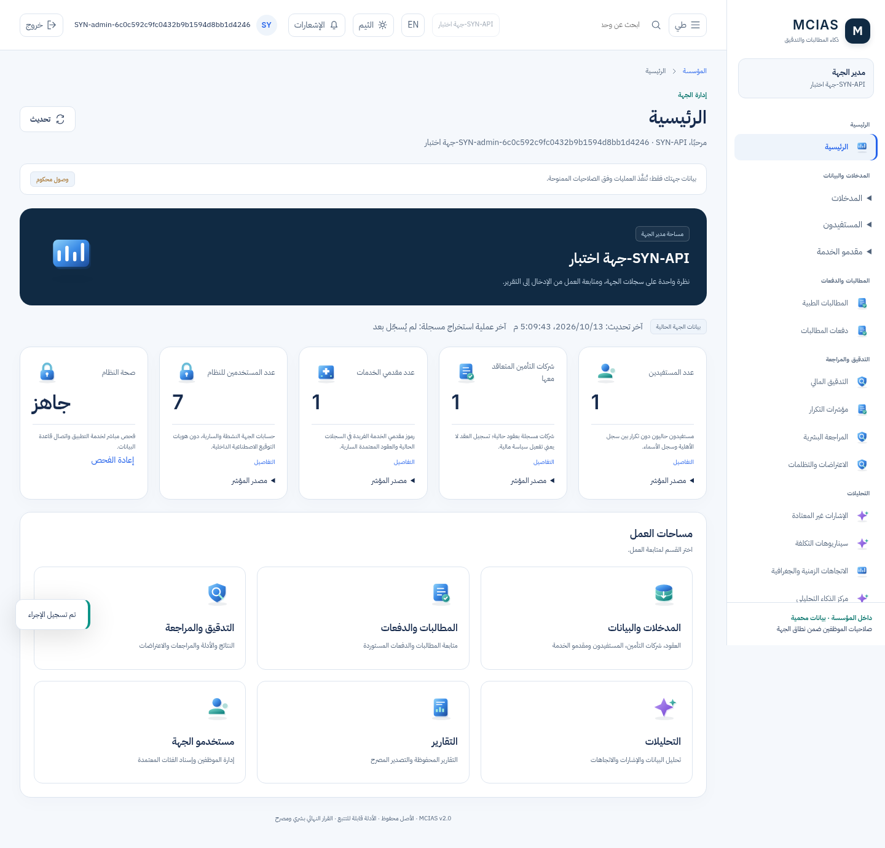
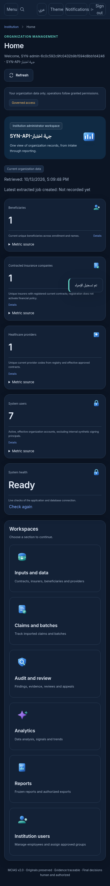

# واجهة مدير الجهة — التنفيذ والتشغيل

## النطاق

الفرع `feat/windows-laptop-testing`. واجهة مدير الجهة تستخدم Backend وواجهة Vanilla JavaScript الحاليين، وتحتفظ بواجهة الإدارة التقنية المنفصلة. لا تمنح هذه الواجهة اعتمادًا ماليًا نهائيًا تلقائيًا.

القائمة بالترتيب المطلوب: **الرئيسية ← المدخلات والبيانات ← المطالبات والدفعات ← التدقيق والمراجعة ← التحليلات ← التقارير ← مستخدمو الجهة**. تظهر الوحدات المتاحة بحسب الميزات والصلاحيات الفعلية؛ لا تعرض الوحدات المخطط لها كوظائف عاملة.

## تشغيل اللابتوب

حدّث الفرع بالطريقة الواردة في [دليل تسليم Codex](CODEX_LAPTOP_HANDOFF_AR.md)، ثم شغّل Start وCheck وCredentials باستخدام `scripts/laptop.ps1`.

استخدم **`SYN-laptop-institution-admin`**؛ كلمة المرور وTOTP محفوظان بصورة خاصة ويعرضهما Credentials محليًا. الحساب `SYN-laptop-admin` يبقى حساب الإدارة التقنية، وليس واجهة مدير الجهة المطلوبة.

التحديث يحافظ على معرفات الحسابين السابقين وكلمات المرور وMFA وبيانات اللابتوب. لا تحذف volumes أو تغيّر مفاتيح التشفير. إضافة حساب مدير الجهة اصطناعية ومحصورة في `mcias_laptop_e2e` ووضع التطوير، وليست تهيئة لجهة إنتاجية.

## تعريف المؤشرات

| المؤشر | البيانات وطريقة العد |
|---|---|
| المستفيدون | اتحاد رموز المستفيدين الفريدة من الأهلية السارية بتاريخ اليوم ومن آخر إصدار مفتوح سارٍ لسجل أسماء المستفيدين؛ دون عد الرمز مرتين |
| شركات التأمين المتعاقد معها | رموز شركات التأمين الفريدة في آخر سجلات `inputs.insurers` المفتوحة السارية، مع رقم عقد إلزامي؛ لا تُعد العقود مع مقدمي الخدمات شركات تأمين |
| مقدمو الخدمات | اتحاد رموز المستشفيات والعيادات والمختبرات والأشعة والصيدليات الحالية، مع مقدمي الخدمات ذوي العقود المعتمدة السارية عند وجود صلاحية قراءة العقود |
| مستخدمو الجهة | حسابات الجهة المفتوحة والنشطة والسارية؛ تستبعد هويات التوقيع الاصطناعية الداخلية التي لا تقبل تسجيل الدخول |
| صحة النظام | نتائج فعلية من `/health/live` و`/health/ready`، مع تمييز الخطأ أو عدم الجاهزية |

قراءة كل مؤشر تخضع لصلاحية الوحدة وميزة الجهة. المؤشر المحجوب يعيد `value=null` وحالة `restricted`، لا صفرًا يوحي بعدم وجود بيانات. العد لا يكشف سجلات جهة أخرى أو حقولًا شخصية في استجابة اللوحة.

سجل عقد شركة التأمين مدخل مسجل، ولا يثبت اعتماد سياسة مالية أو نفاذ العقد مؤسسيًا. تظهر هذه الحدود في الواجهة. لا تُنشأ شركات تأمين أو مستفيدون أو مقدمو خدمات تلقائيًا لغرض ملء المؤشرات.

الاستجابة تتضمن `retrieved_at` و`as_of`، وتسمّي آخر تاريخ **إنشاء** مهمة استخراج ناجحة `last_extracted_job_created_at`؛ هذا ليس توقيت انتهاء المهمة أو مزامنة شاملة. قراءة سجل المدخلات تخضع لحد 10,000 حدث موجود في طبقة السجل؛ عند تجاوز الحد تظهر مشكلة مصدر، ولا يُعاد عد جزئي صامت.

## إدارة الموظفين

- قائمة فعلية وبحث حرفي وتصفية مفتوح/مغلق وترقيم صفحات داخل الجهة.
- إنشاء حساب بكلمة مرور أولية، دون منح تلقائي للصلاحيات.
- إسناد وسحب الفئات الوظيفية المعتمدة والمراجعة فقط.
- إغلاق الحساب مع سبب وتأكيد وحفظ التاريخ؛ دون حذف فعلي.
- إخفاء أدوات تعديل الحساب الذاتي والحسابات التقنية، مع رفض العمليات غير المسموحة في Backend.
- لا تحرير لصلاحيات الفئات في هذه الشاشة، ولا تجاوز للاعتماد المالي أو التوقيع المستقل لمنحها.

تستخدم العمليات الكتابية API وخدمات RBAC الحالية، ويُسجل أثرها في سجل التدقيق ضمن المعاملة الحالية.

## المسارات الجديدة

| النوع | المسار | الحماية |
|---|---|---|
| API قراءة | `GET /api/v1/institution/overview` | مصادقة، `reports.read`، ميزة الملخص، وتفويض مستقل لكل مؤشر |
| API قراءة | `GET /api/v1/institution/users` | `users.read` وميزة قائمة المستخدمين وعزل الجهة |
| API قراءة | `GET /api/v1/institution/assignment-groups` | `users.read` و`groups.read` وميزة قائمة المستخدمين؛ فئات وظيفية موثوقة فقط |
| واجهة | `/institution/inputs/insurers` | ميزة `inputs.insurers` وصلاحيات العقود الحالية |
| واجهة إدارة تقنية | `/admin/inputs/insurers` | نفس ميزة وصلاحيات سجل العقود بحسب حساب الإدارة |

تستعمل `/institution/dashboard` و`/institution/users` المسارين الموجودين مع تنفيذ واجهة مدير الجهة الجديدة. حسابات المراجعة الأخرى تحتفظ بعرضها المسموح.

## قاعدة البيانات والتوافق

الترحيل الجديد `0023_insurer_intake` يضيف ورقة كتالوج واحدة `inputs.insurers` تحت `inputs`. الكتالوج يصبح 45 ميزة: 11 حاوية و34 ورقة. لا تعديل لترحيلات 0019 أو0021 أو0022، ولا جداول أعمال جديدة، ولا بيانات جهات أو منح في الترحيل. تستخدم الميزة صلاحيات العقود الموجودة؛ لا زيادة على كتالوج الصلاحيات الحالي.

توقعات رأس الترحيل وفحص G9 تواكب `0023_insurer_intake` مع استمرار رفض النسخ غير المطابقة. downgrade لا يتجاوز مراجع منح الميزات الموجودة ولا يمحو تاريخها.

تهيئة اللابتوب تمنح حساب الاختبار الجديد الأوراق غير التقنية للجهة عند الإنشاء الأول فقط. لا تستعيد التهيئة المتكررة صلاحيات أو ميزات سُحبت لاحقًا. صلاحيات الإنتاج تتطلب إجراءات الجهة ومفاتيح اعتمادها؛ التوقيع الاصطناعي محصور في وضع الاختبار.

## أدلة التحقق

- 555 اختبار Python ناجح مع PostgreSQL وقواعد اختبارات معزولة؛ 33 تحذيرًا في التشغيل الموثق.
- 18 اختبار JavaScript ناجح وفحص صياغة الوحدات.
- Chromium حقيقي عبر HTTP وPostgreSQL: 30 صفحة مسموحة، إنشاء سجلات شركات تأمين ومستفيدين ومقدمي خدمات وتغير المؤشرات، وإنشاء موظف وإسناد فئة وسحبها وإغلاقه.
- فحوص العربية RTL والإنجليزية LTR، الوضعين، وعروض 1440 و768 و390؛ دون أخطاء JavaScript أو مخالفات إمكانية وصول في الشاشات المفحوصة.
- تحديث Docker من نسخة الحسابين إلى ثلاثة حسابات مع بقاء كلمات المرور وMFA والبيانات، وفحوص تشغيل وحفظ بيانات ناجحة.

هذه نتائج هندسية في بيئة سحابية Linux. لا تمثل اختبار Windows الفعلي أو القبول المؤسسي أو UAT أو اختبار اختراق. CI يجب قراءته للـCommit المنشور نفسه في PR #17.

## معاينات

العربية، سطح المكتب:

الإنجليزية، الهاتف:

## English summary

The institution administrator gets seven ordered workspaces and five live, tenant-scoped dashboard indicators. Insurance companies are counted separately from healthcare providers. Staff lifecycle operations use the existing reviewed RBAC APIs. Technical administration and final financial approval remain separate. Migration `0023_insurer_intake` adds one catalog leaf. The laptop-only `SYN-laptop-institution-admin` account has a locally generated password and MFA; existing credentials and data survive upgrades. Cloud tests do not constitute Windows or institutional acceptance.
