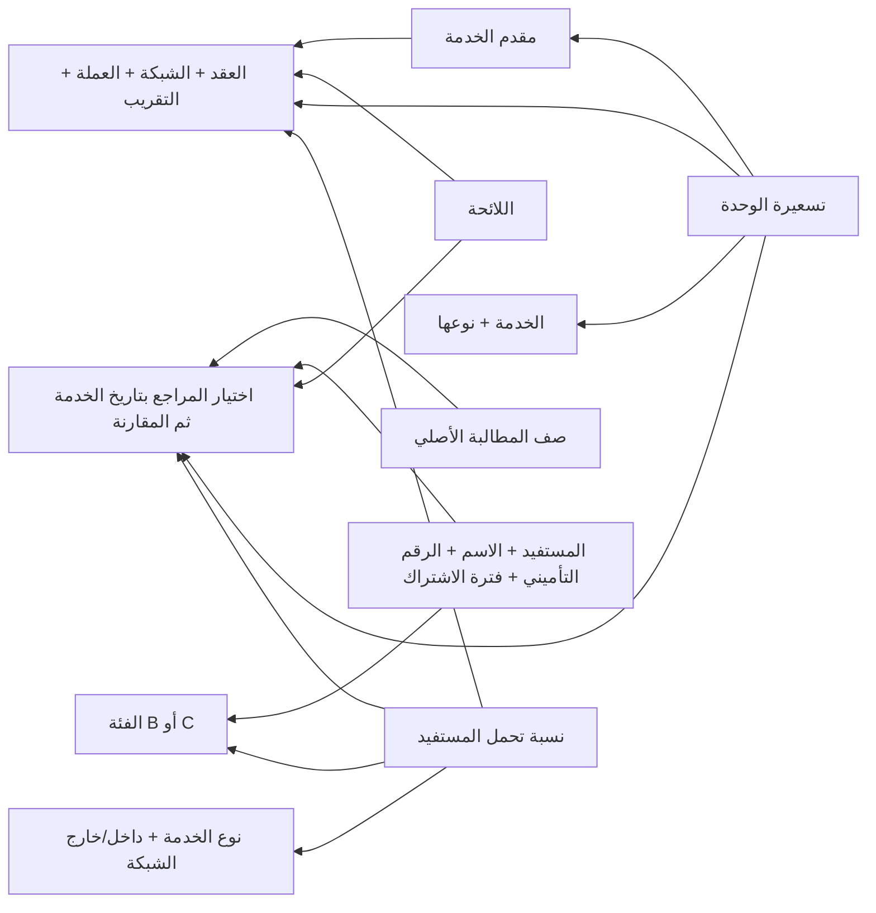

# ربط المدخلات وفحص المطالبات — بيانات اصطناعية

## ما أضيف

أعيد استخدام سجل المدخلات المشفر وإصداراته وشاشاته القائمة. لم تُنشأ جداول
SQL مكررة للعقود أو المستفيدين، ولم يُعدّل أي Migration. العلاقات هنا روابط
معرفات بين سجلات المدخلات، تتحقق منها الخدمة داخل الجهة نفسها، وليست Foreign
Keys جديدة على مستوى PostgreSQL. لا تحل هذه الروابط محل المراجع المالية
المعتمدة في G3؛ مرحلة الفحص الجديدة أولية قبل التدقيق المالي والاعتماد.

## الجداول التي يراها المستخدم

| القسم | البيانات والروابط |
|---|---|
| شروط العقود | مقدم مرتبط، رقم العقد، العملة، التقريب والدقة، داخل/خارج الشبكة، وبنود مرقمة محفوظة |
| اللوائح | عقد مرتبط، مبلغ المطالبة NET بعد التحمل، بند خدمة لكل صف، واشتراط مطابقة الاسم |
| الفئات | رمز الفئة واسمها؛ بيانات المثال B وC |
| نسب التحمل | الفئة والعقد ونوع الخدمة والشبكة ونسبة **تحمل المستفيد** |
| المستفيدون | الاسم والرقم التأميني والفئة المرتبطة وبداية/نهاية الاشتراك |
| المزودون | الاسم ورمز المزود؛ مستشفى داخل الشبكة وعيادة خارجها في المثال |
| الخدمات والأسعار | الخدمة ونوعها؛ تسعيرة مرتبطة بالمزود والخدمة والعقد والعملة وفترة السريان |

في نموذج الإضافة/التعديل، «روابط وقواعد الفحص» يعرض قوائم اختيار للسجلات
المسموح بقراءتها. اختيار الفئة/المزود/الخدمة يملأ رمزها المقابل؛ يتحقق الخادم
من توافق الرموز والروابط. لا يُقبل رابط أجنبي أو مفقود أو ربط سعر بعقد مزود
مختلف. يمنع تداخل نسب التحمل/التسعيرات المرتبطة والاشتراكات ذات الهوية نفسها.
المدخل القديم غير المرتبط لا يُحذف؛ يبقى محتاجًا لاستكمال الروابط قبل المطابقة.

## البيانات الاصطناعية

`mcias/seed/linked_references.py` يجهز **50 سجلًا مترابطًا**:

- فئتان و4 مستفيدين: موظف وزوجة وابن في B، ووالد في C.
- مزودان، وعقدان و6 شروط عقد، ولائحتان و4 بنود لائحة.
- 4 خدمات و8 تسعيرات و16 قاعدة تحمل بحسب الفئة والخدمة والشبكة والعقد.

تضاف إلى المدخلات الاصطناعية السابقة دون استبدالها. لا يمنح الإعداد أي حساب
موظف صلاحيات، ولا ينشئ اعتمادًا ماليًا. الإعداد محصور في development مع
`MCIAS_LAPTOP_TEST_MODE=synthetic_localhost` وجهة اسمها يبدأ بـSYN- وسوبر أدمن
لديه MFA. إعادة تشغيل setup تتخطى السجلات الموجودة ولا تعيد كتابتها.

هذه النسب والأسعار أمثلة اختبار، وليست شروط عقد الجهة الحقيقية:

| المستفيد | الفئة | الخدمة | الشبكة | السعر | تحمل المستفيد | الصافي المتوقع |
|---|---|---|---|---:|---:|---:|
| موظف تجريبي | B | زيارة طبيب | داخل | 1000 | 10% = 100 | 900 |
| الموظف نفسه | B | فحص مخبري | داخل | 200 | 30% = 60 | 140 |
| والد تجريبي | C | زيارة طبيب | داخل | 1000 | 50% = 500 | 500 |
| زوجة تجريبية | B | زيارة طبيب | خارج | 1200 | 30% = 360 | 840 |

دقة منزلتين وHALF_UP والعملة LYD قيم صريحة **في عقد المثال الاصطناعي فقط**.
لا يُفرض تقريب أو عملة أو نسبة على عقد حقيقي لم يحددها المخول.

## مسار فحص ملف الشركة

1. ارفع Excel من «التدقيق والمراجعة»؛ الأصل يبقى محفوظًا ببصمته دون تعديل.
2. أكد ربط الرقم التأميني والاسم والمزود والخدمة والتاريخ والصافي. حدد أيضًا
   أعمدة الفئة والسعر والمطلوب قبل التحمل ومبلغ/نسبة التحمل حسب ما يتوفر.
3. أكمل استيراد الصفوف الصالحة. وجود مستورد يملك claims.read وclaims.review
   يشغل فحص المدخلات تلقائيًا بعد اكتمال الاستيراد؛ غير المخول لا ينفذه تلقائيًا.
4. الفحص يطابق الهوية بالرقم التأميني ثم يقارن الاسم؛ لا يطابق أسماء تقريبية
   ولا يختار من هويات/مزودين/تسعيرات متعارضة تلقائيًا.
5. يختار اشتراك المستفيد وفئته، والمزود والخدمة وتسعيرته والعقد واللائحة
   وقاعدة التحمل السارية **بتاريخ الخدمة**. البداية مشمولة والنهاية غير مشمولة.
6. يقارن السعر، ونسبة التحمل ومبلغه، والصافي واتساق أرقام الشركة. الحساب
   يستخدم Decimal وتقريب العقد؛ الصافي لا يُخصم منه تحمل ثانٍ.
7. تظهر النتيجة لكل بند وإصدارات المراجع والأدلة الحسابية في الصفحة. يمكن
   إعادة الفحص؛ يحفظ نسخة جديدة عند تغير المراجع، ويتخطى النسخة المطابقة.

| نتيجة الفحص | المعنى |
|---|---|
| MATCHED | مطابق للمدخلات المحددة في الفحص الأولي؛ لا يعني إتمام التدقيق المالي أو اعتماد الدفع |
| REVIEW_REQUIRED | اختلاف مثل الاسم/الفئة الواردة/السعر/النسبة/الصافي؛ يحتاج مراجعة |
| BLOCKED | مرجع أو عمود أو تسعيرة أو اشتراك مفقود، أو هوية غامضة أو أرقام غير صالحة |

إذا وُجد نقص واختلاف معًا، تظهر BLOCKED وتبقى تفاصيل الاختلاف محفوظة.
غياب تسعيرة لا يتحول إلى رفض مؤكد ولا يُستبدل بسعر الفاتورة تلقائيًا. سياسة
بدائل أسعار الأدوية/بعض الفحوصات تحتاج مرجعًا مصرحًا وتكاملًا ماليًا لاحقًا.

## API والإذن

- `POST /api/v1/claims/batches/{id}/reference-checks`: فحص/إعادة فحص، claims.read
  وclaims.review؛ يعيد ملخصًا ويحفظ الأدلة المشفرة ضمن المعاملة.
- `GET /api/v1/claims/batches/{id}/reference-checks`: آخر نسخة محفوظة بالصفحات،
  الصلاحيتان نفسيهما، ومع عزل الجهة.
- `/registry/{feature}/schema` يعرض روابط الاختيار وشروط القسم المسموحة.
- `/claims/batches/{id}/mapping` يقبل الأعمدة الإضافية المؤكدة، ولا يسمح بتغيير
  الربط بعد استيراد أي صف. العمود الأصلي لا يُعاد تحريره.

## حدود النطاق

الفحص الأولي المضاف ليس وكيل OCR أو تفسيرًا آليًا لنصوص العقود واللوائح.
المقارنة تعتمد الحقول والشروط المهيكلة المحددة، ولا تدعي تنفيذ كل بند نصي
أو فحص السقوف والاعتمادات والاستثناءات والطب والتكرار الكامل.

وقت اكتمال هذه المرحلة، كان محرك G5 يتوقع مبلغًا قبل التحمل، وأضيف حاجز يمنع
تمرير دفعة NET إليه وخصم التحمل مرة ثانية. هذا الوصف تاريخي؛ في طلب المالك
اللاحق أُضيف مسار NET صريح يعيد استخدام الحساب والسياسات الموقعة والتحقق
المستقل القائمين. تفاصيله وحدوده في `NET_CYCLE_VALIDATION_AR.md`.
لم يُخفف شرط موافقات G5، ولا ينقل MATCHED بندًا غير مدقق إلى ملف المقبول
تلقائيًا. ملفات النتائج الأربعة تحتفظ بمعناها المبدئي؛ هذا ليس إثباتًا لاكتمال
كامل القواعد الطبية والتعاقدية أو جميع الوكلاء.

لا Commit/Push ولا حذف بيانات أو تغيير Migration ضمن هذا العمل. نتائج الاختبارات
الفعلية وحدود PostgreSQL/Windows/CI تسجل في `IMPLEMENTATION_PROGRESS_AR.md`.
