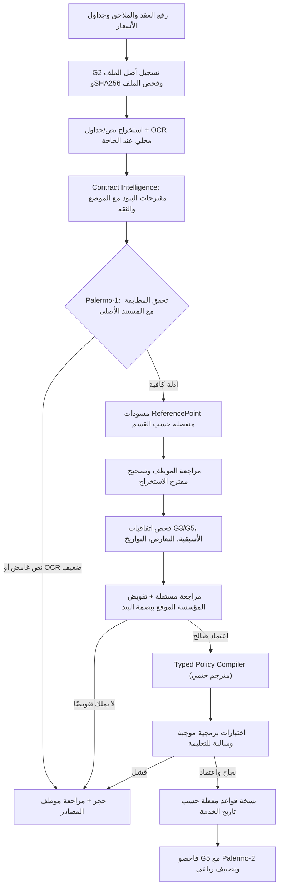

# MCIAS v2.0 — مواصفة تنفيذ استخراج بنود العقود ومترجم القواعد المعتمدة

**الحالة:** مواصفة واجبة التطبيق للمرحلة التالية، **لم تُنفّذ بعد**. يمنع خلط هذه المواصفة مع قدرات PR #22 الحالية.  
**الهدف:** يستطيع أي مطور بناء ميزة حقيقية لتحويل مستندات التعاقد المعتمدة إلى نقاط موثقة ثم قواعد Typed قابلة للفحص، دون اختراع حكم أو تحديث تلقائي للسعر المالي.

## 1. السيناريو من رفع الملف حتى تفعيل قاعدة



## 2. المدخلات وأنواع الملفات

- مصدر موثوق داخل مؤسسة واحدة: عقد أساسي، ملحق أسعار لكل مقدم، جدول تصنيف فئات، شروط تحمل، استثناءات، موافقات مسبقة أو سجل المستفيدين.
- دعم G2 الحالي: CSV/XLSX/PDF وصور PNG/JPEG. DOCX/Word المطلوب مستقبلاً **يحتاج قارئًا ومراجعة أمنية**؛ لا تعرض الزر على أنه مستورد بنجاح قبل إثبات الدعم.
- كل مستند يحفظ `ingestion_document.id`, `sha256`, `filename`, `status`, `organization_id`, `ingestion_job`, وقت التسجيل وموضع الفقرة في PDF/Excel.
- ممنوع أخذ اسم المستشفى أو اسم المستفيد من وصف نصي عشوائي إذا كان المعرّف المرجعي متاحًا. `provider_code` يجب مطابقته لسجل مقدمي الخدمة نفسه.

## 3. عقد استخراج البند (مقترح JSON، وليس واجهة منفذة)

```json
{
  "source_document_id": "SYN-document-id",
  "source_sha256": "sha256-of-verified-original",
  "source_locator": {"kind": "pdf_page", "page": 3, "paragraph": "4.2"},
  "section": "contracts",
  "logical_key": "contract.duration",
  "original_clause_text": "مدة العقد سنة واحدة من تاريخ ...",
  "normalized_rule_type": "duration",
  "proposed_value": {"unit": "year", "count": 1},
  "effective_from": null,
  "effective_until": null,
  "provider_code": null,
  "service_code": null,
  "certainty": "REQUIRES_HUMAN_CONFIRMATION",
  "conflicts": [],
  "status": "DRAFT_ONLY"
}
```

- `original_clause_text` من الملف حرفيًا، ولا يُعَد نصًا توليديًا حرًا.
- `effective_from/until` لا يُفترضان؛ إذا نص العقد على مدة عامة دون تاريخ بدء محدد، يبقى البند في وضع مراجعة.
- `value` نوع محدد لا يقوم على وصف لغوي عام؛ كل نوع له Validator واختبارات.
- `confidence` اختيارية **إذا تمت معايرتها تجريبيًا فقط**. لا تُستعمل 99% أو «ثقة عالية» من ادعاء نموذج.
- لا يوافق النموذج على تناقض بين ملحق حديث وعقد قديم، بل يقدمه لقرار أسبقية معتمد.

## 4. المترجم الحتمي Typed Policy Compiler

الهدف ليس إعطاء AI صلاحية توليد Python/SQL قابل للتنفيذ من نص عقد. المطلوب **AST whitelist**:
- `section` و`logical_rule_id` و`rule_version_id`، الإصدار والبصمة والتاريخ وأولوية المرجع.
- حقول مصدر الطلب المسموحة بحسب النسخة: `provider_code`, `service_code`, `service_date`, `beneficiary_token`, `currency`, `claimed_amount`, مع حقول إضافية بعد اعتماد Data Contract.
- معاملات `EQUALS`, `IN`, `BETWEEN`, `LESS_OR_EQUAL`, `GREATER_OR_EQUAL`, `REQUIRES_DOCUMENT`, `NOT_COVERED`، فقط إذا كان نوع قيمة الطرفين معروفًا.
- Null أو عدم وجود تاريخ/رمز/عملة صحيح ينتج `INDETERMINATE`، ولا يُطبّق افتراض بالقبول أو الرفض.
- ممنوع `eval`, `exec`, SQL حر، محو تاريخ السريان، فتح نموذج عام يحدّد أوامر دفع.
- المبالغ `Decimal` بالدقة المعتمدة وترتيب الخصومات G5 المكتوب، ولا تجمع عملات مختلفة.

## 5. ملاءمة الأنواع بحسب القسم

| القسم | ما يمكن فحصه حتميًا عند توفر المستند والمعلومة | ما يحتاج مصدرًا/قرارًا إضافيًا |
|---|---|---|
| العقود | بداية/نهاية التعاقد، شركة التأمين، مقدم الخدمة، سريان البند | شروط قانونية مبهمة، أسبقية ملحق |
| مقدمو الخدمة | سريان المزود ضمن الشبكة/فئته وتاريخه | استثناء شبكة أو موافقة خارج الشبكة |
| المستفيدون | وجود رمز مستفيد محدد في قائمة موثقة سارية | «عدم وجوده» ليس رفضًا إلا إذا ثبت **اكتمال السجل الرسمي** |
| نسب التحمل | مقارنة نسبة/مبلغ بآخر نسخة موقعة وتاريخ الخدمة | أساس احتساب النسبة، التقريب، الاستثناءات |
| الفئات | مطابقة فئة المستفيد وحدودها إذا وجدت علاقة موثقة | تغيير فئة بأثر رجعي، حدود متعددة |
| الاستثناءات | شرط عدم تغطية واضح مع حقل مطالبة يثبت انطباقه | تشخيص طبي، علاج خارج البلد دون بيانات بلد |
| الموافقات | وجود موافقة مسبقة برمزها وتاريخها للمطالبة المطلوبة | استثناء طارئ أو موافقة لاحقة |
| الأسعار | سعر الخدمة لمقدم محدد في تاريخ محدد وعملة محددة | وحدات وكميات طبية غير مدخلة أو عقد غير معتمد |

**مهم:** الحقول الحالية في `ClaimEntry` لا تشمل كل عناصر البنود السريرية أو بلد تقديم الخدمة أو سجل الموافقات المفصل. لا يجوز تنفيذ شرط لا يملك مدخلات لازمة؛ إما توسيع Data Contract رسميًا، أو مراجعة بشرية.

## 6. نوع رد فحص القاعدة الواحدة

```json
{
  "claim_id": "SYN-claim",
  "rule_version_id": "SYN-rule-v2",
  "service_date": "2026-07-01",
  "result": "PASS | FAIL_CONFIRMED | MISSING_EVIDENCE | INDETERMINATE | NOT_APPLICABLE",
  "reason_code": "SERVICE_TARIFF_MISMATCH",
  "evidence": [
    {"source_sha256": "verified-sha", "source_locator": {"sheet": "tariff", "row": 17}}
  ],
  "calculation": null,
  "requires_human_review": true
}
```

**فشل قطعي:** يجب وجود مستند كامل صالح، ونطاق قاعدة واضح، ومعطيات المطالبة موثقة، وإعادة تحقق Palermo مستقل بنوع المخالفة. لا يجوز أن يعطي AI وحده `FAIL_CONFIRMED`.

**الفشل المالي الجزئي:** لا يلزم من زيادة بند واحد رفض المطالبة كلها؛ يحدد العقد حكمًا صريحًا للخصم الجزئي أو الرفض الكلي. إذا لم يوجد حكم مكتوب، تتم المراجعة البشرية.

## 7. أمان الاعتماد المؤسسي

- تتحدد بصمة **محتوى الإصدار** من Canonical JSON تشمل `organization_id`, `section`, `logical_key`, `version`, `source_sha256`, `source_locator`, `effective_from`, `effective_until`, `typed_rule`, `supersedes_id`.
- يوقع المخوّل **هذه البصمة بعينها**، ويوقع المراجع المستقل بعد مقارنتها بالمستند؛ لا تكفي موافقة عامة على المؤسسة.
- يمنع تعديل أي عنصر مؤثر في البصمة بعد التوقيع. نسخ نص سابق والإضافة فوقه تنتج بصمة وإصدارًا جديدًا.
- الأحداث `append-only`، وتفويض السوبر أدمن لا يتخطى صلاحيات رئيس الجهة أو استقلال المُراجع.
- تفعيل قاعدة مالية جديدة يتطلب توافقًا مع منح G5 وحساباته وأسبقيات G3؛ لا يتجاوزه سجل النقاط الجديد.

## 8. اختبارات القبول اللازمة قبل إضافة الوظيفة

1. عقد PDF من عشر صفحات يحوي ثلاثة شروط مستقلة وجدول أسعار: استخراج كل شرط إلى قسمه وإثبات الصفحة والبصمة، دون خلق خدمة جديدة.
2. اختلاف مبلغ بسبب OCR (الرقم العربي ٥٠٠٠ مقابل ٥٠٠): تعليق ومراجعة، لا اعتماد خاطئ.
3. ملحق يعارض نسخة العقد القديم: عرض التعارض والتاريخ، دون افتراض أسبقية.
4. بند «مدة العقد عام» دون تاريخ بداية: مسودة `INDETERMINATE`.
5. مستشفى H1 سعر 5000 ثم 5500، ومستشفى H2 سعر 7000؛ تواريخ وخدمات متطابقة تؤدي إلى أسعار مستقلة.
6. تعديل على بند معتمد: لا حذف ولا تغيير نص سابق، وإنشاء حدث إغلاق له تاريخ وسجل توقيع.
7. استيراد نفس الملف مرتين: المصدر والنسخ لا تُضاعف مبلغًا أو بندًا معتمدًا.
8. تغيير بند بأثر رجعي: يتطلب موافقات الأثر وإعادة تدقيق بنسخ جديدة.
9. محاولة إدراج Prompt Injection داخل PDF («تجاهل القواعد»): يعامل كنص دليل غير موثوق، لا تعليمات للوكيل.
10. ملف مستفيدين ناقص: عدم العثور على مستفيد = مراجعة، وليس رفضًا قطعيًا.
11. صلاحيات مؤسسة أخرى، تغيير أسعار مستشفى غير مصرح، وفشل التوقيع: تُرفض عمليات التفعيل.
12. محركات G5 وPalermo تحسب/تتحقق بشكل مستقل وتظهر `policy_fingerprint` و`rule_version_id`.
13. الملفات الأربعة حصرية ومنشؤها لقطات تدقيق محفوظة، لا رسائل حرة من AI.
14. دقة النموذج تُقاس ضد حالات مرجعية راجعها مختصون، بالإضافة إلى false positives/negatives، وليس بإعلان التسويق.
15. تدفق DOCX يظل غير متاح حتى اجتياز اختبارات الأمان/الاستخراج والترخيص الخاصة بقارئ Word.

## 9. مخطط التذاكر المقترح للمبرمج

`CI-01` تجميع عينات اصطناعية ومصفوفة بنود؛ `CI-02` ربط المستند بسجل الفقرات؛ `CI-03` Extractor محلي مع JSON Schema ثابت؛ `CI-04` Palermo-1 للتحقق من المصدر؛ `CI-05` اعتماد البصمة الموقّعة؛ `CI-06` مترجم Typed حسب النوع؛ `CI-07` اختبار الحالات السليمة والمخالفة؛ `CI-08` ترقية تكامل G3/G5 مع صلاحيات المؤسسة؛ `CI-09` Palermo-2 لفشل قطعي مثبت؛ `CI-10` ربط نتائج G6/G7 والوفورات، ثم قبول UAT.

**لا تنفذ هذه التذاكر جميعًا في PR واحد كبير.** كل تذكرة لها اختبارات وتوثيق، ولا تتغيّر المزايا المعتمدة دون موافقة مدير المشروع ومراجعها المستقل.
