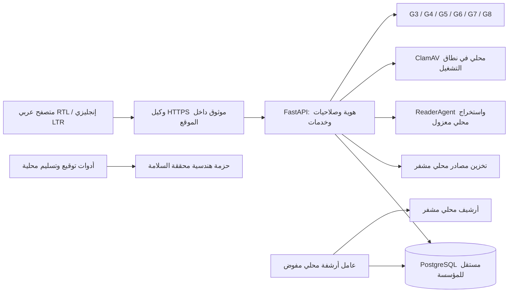
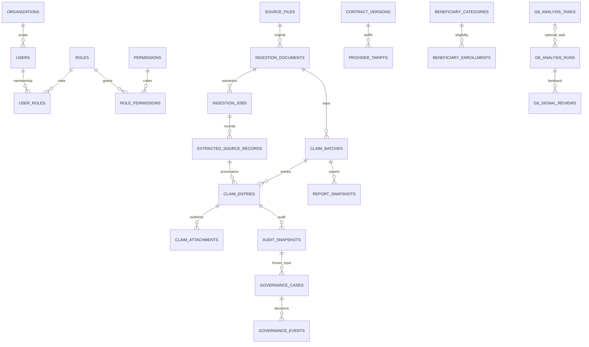
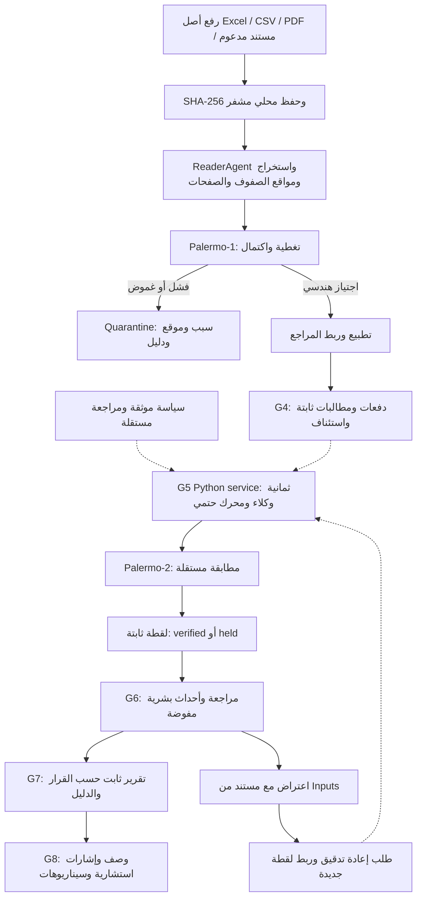

# MCIAS v2.0 — المرجع الرئيسي للتصميم والبنية والتنفيذ

معرّف الوثيقة: `MCIAS-DES-001` · الإصدار: 1.0 · تاريخ التثبيت: 2026-10-10 UTC

الحالة: **ENGINEERING_BASELINE / PENDING_INSTITUTIONAL_APPROVAL**.

[English version](MCIAS_MASTER_DESIGN_BASELINE_EN.md) · [حزمة القبول](ACCEPTANCE_PACK_INDEX.md) · [عقد القبول الملزم](ACCEPTANCE_CONTRACT.md)

## دليل القراءة

الأقسام 1–2: الحجية والمتطلبات؛ 3–5: البنية وقاعدة البيانات والتدفق؛ 6–7: التدقيق والصلاحيات؛ 8–10: الواجهات والتقارير والتشغيل؛ 11–14: القبول والإنجاز والأدلة والفجوات وإدارة النسخة.

## 1. نطاق المرجع وحجية الاعتماد

هذه وثيقة رئيسية تجمع تصميم MCIAS المنفذ ومتطلباته وبنيته وحالة إنجازه. كلمة baseline تعني النسخة الهندسية المراجعة والمجمعة على main؛ لا تعني توقيع الجهة على جميع الخيارات أو قبول G0–G9. لا يوجد في المستودع توقيع مؤسسي يتيح وصف هذه الحزمة بأنها تصميم إنتاجي معتمد بالكامل.

- المستودع: [overurdream-collab/test2](https://github.com/overurdream-collab/test2).
- الفرع المرجعي: `main`؛ SHA المثبت: `5c8b63a209e4f44a8faaf9a38a05c81d92512dda`.
- اكتمل تجميع النسخة الهندسية في PR #14، وإضافة الحزمة الثنائية اللغة في [PR #15](https://github.com/overurdream-collab/test2/pull/15) المدمج.
- المواصفات هنا تمثل الشيفرة عند SHA المثبت. أي تعديل لاحق يحتاج نسخة جديدة وأدلة خاصة به؛ نجاح CI القديم لا يغطي commit أحدث.
- ترتيب الحجية: عقد القبول، ثم قرارات الجهة الموقّعة ضمن نطاقها، ثم هذا المرجع ومصفوفة التغطية. الشيفرة والاختبارات دليل سلوك هندسي؛ التعارض مع متطلب ملزم يُسجل فجوة، ولا يغيّر العقد تلقائيًا.
- سجلات الفروع وCI القديمة في الوثائق أدلة تاريخية؛ المرجع الحالي main. ADR-003 الذي اقترح React/TypeScript لا يصف الواجهة المنفذة حاليًا.

| المصطلح | المعنى في هذه الوثيقة |
|---|---|
| منفذ هندسيًا | شيفرة موجودة وقابلة للتشغيل، مع أدلة تحقق محددة عند توفرها؛ دون قبول مؤسسي ضمني |
| جزئي | جزء من المتطلب متصل بخادم فعلي؛ القدرات المفقودة مذكورة |
| مخطط / غير متاح | شاشة إرشادية أو متطلب بلا API تشغيلية مناسبة |
| محجوب | يحتاج تطويرًا أو بيانات أو تفويضًا أو معيار قبول لم يتوفر |
| معتمد مؤسسيًا | توقيع بشري مفوض وكل شروط العقد؛ **لا توجد بوابة مسجلة ACCEPTED** |

حقول اعتماد هذا المرجع: المالك، المراجع المعماري، المسؤول المالي، مسؤول الخصوصية، نسخة السياسات، SHA وحزمة الأدلة، نطاق المؤسسة، التاريخ والتوقيعات. جميعها `NOT_RECORDED / NOT_SIGNED` حتى تعبئتها بواسطة الجهة.

## 2. الغاية والمتطلبات الوظيفية

MCIAS نظام داخل موقع الجهة للإشراف على المطالبات والتكلفة والتغطية والعقود والأدلة والمراجعة البشرية والتقارير. يهدف إلى تمكين تحليل قابل للتفسير والتتبع؛ لا يصدر حكم علاج، أو اتهام احتيال، أو دفعًا تلقائيًا.

| المتطلب | السلوك المطلوب | ما تحقق / حد التغطية |
|---|---|---|
| الهوية والأمان | جلسات وMFA وRBAC ومنع وصول غير مفوض | منفذ هندسيًا؛ سلطة الهويات والمفاتيح وفحص البيئة الخارجية تنتظر الجهة |
| المصادر والإدخال | حفظ الأصل المشفر والتجزئة وموقع الصف/الصفحة والعزل | ReaderAgent وPalermo-1 وواجهات إدخال؛ دقة OCR المؤسسية والتنزيل الأصلي المحكوم غير مكتملين |
| المراجع | عقود وتسعيرات وفئات وأهلية بتاريخ الخدمة | نسخ زمنية ومنع تعارضات؛ أولوية العقود والقواميس الرسمية تنتظر اعتمادًا |
| المطالبات | دفعات واستئناف ومرفقات وأعمدة أصلية ثابتة | G4 منفذ؛ حجم تشغيل الجهة وSLA غير معتمدين |
| التدقيق المالي | ثمانية وكلاء ومحرك حتمي وPalermo-2 | محرك ولقطات وقراءة أدلة؛ **لا توجد API لتنفيذ G5 إنتاجيًا** |
| الحوكمة | فصل الواجبات واعتراض ودليل وإعادة تدقيق مرتبطة | أحداث G6 ثابتة؛ محرر المراحل والتعيين والتصعيد والاستئناف الشامل غير متاح |
| التقارير | Excel/PDF ولقطات وبيانات مستفيد محكومة | G7 منفذ جزئيًا؛ قوالب الجهة وحقوق الحقول ومطابقة بيانات حقيقية تنتظر اعتمادًا |
| الذكاء والتحليل | وصف واتجاهات وإشارات ومهام محكومة | G8 وصفي وحتمي واستشاري؛ لا دردشة توليدية أو وكيل قرار ذاتي |
| الإدارة التقنية | مصادر وقواعد وسياسات ومهام وصحة وأرشفة | واجهة فعلية لبعض العمليات؛ لا CRUD شامل للمؤسسات/المستخدمين/الأدوار |
| التشغيل والإصدار | بناء وتحقق واستعادة وتوثيق واختبارات | أدوات CI وتسليم وفحص محلي؛ النشر المؤسسي وPenTest وUAT والتوقيع لم تنفذ |

هذه المتطلبات لا تثبت اكتمال جميع وظائف المشروع الأصلي. القسم 8 ومصفوفة API يبينان كل شاشة وحدودها.

## 3. بنية النظام والتقنيات

قرار البنية داخل الموقع: **تثبيت مستقل وقاعدة PostgreSQL وتخزين مصادر مستقل لكل مؤسسة**. وجود organizations وorganization_id لا ينشئ خدمة SaaS متعددة الجهات أو تبديلًا بين قواعد الجهة تلقائيًا. لا يجوز نقل السجلات الطبية إلى خدمات خارجية.



المخطط يصف المكونات؛ TLS وClamAV والمفاتيح والصلاحيات تحتاج تجهيزًا محليًا. لا يثبت أنها منشورة على بيئة الجهة.

| الطبقة | الواقع الهندسي |
|---|---|
| الخادم | Python >=3.11؛ خط CI المثبت يستخدم 3.12؛ FastAPI + Uvicorn + Pydantic Settings |
| البيانات | PostgreSQL 16 في CI؛ SQLAlchemy 2.x + psycopg 3.x؛ Alembic 1.x؛ حدود الاعتماد في pyproject.toml |
| الواجهة | HTML/CSS وJavaScript ES modules محلية؛ JSDoc للعقود؛ لا React/Vite/TypeScript/Tailwind كتطبيق منفذ |
| التحليل المالي | Decimal في Python وNUMERIC في PostgreSQL؛ لا احتساب مبلغ رسمي في المتصفح |
| الملفات والتشفير | AES-GCM محلي؛ SHA-256؛ openpyxl وpypdf وPyMuPDF وPillow؛ OCR محلي بحسب تجهيز البيئة |
| التقارير | openpyxl وReportLab وarabic-reshaper/python-bidi، وخطوط محلية |
| التحقق | pytest/httpx، اختبارات JavaScript عبر Node، Playwright وaxe؛ PostgreSQL حقيقي في التكامل |
| التسليم | wheel وwheelhouse وأرشيف المصدر وإيصالات سلامة؛ Compose قالب هندسي اختياري وليس نشرًا مؤسسيًا معتمدًا |

[اعتمادات المشروع](../pyproject.toml) تحدد نطاقات إصدارات، لا ملف قفل كامل. تثبيت digests والإصدارات وتحضير حزمة غير متصلة معتمدة متطلبات قبل الإنتاج.

```text
mcias/
  app.py, auth.py, policy.py, tenant.py       الخادم وحدود الوصول
  models*.py                                خرائط قاعدة البيانات
  ingestion/                                الإدخال وReaderAgent وPalermo-1
  reference*.py, claims_api.py               المراجع والمطالبات
  audit_*.py, palermo2.py                    G5 والتفويض والمطابقة
  governance_g6*.py                         سجل القرار البشري
  reporting_g7*.py, report_*.py              التقارير الثابتة
  intelligence*_g8.py                       التحليل والمراجعة وStudio
  web_workspace/, web_g7/, web_g8/            الواجهات والأصول المحلية
  seed/, rate_limits.py, retention*.py       الاختبار والضوابط التشغيلية
alembic/versions/                            18 ترحيلًا متسلسلًا
scripts/                                    تشغيل وتحقق وتسليم
tests/, docs/, deploy/                      الاختبارات والتوثيق وقالب النشر
```

المجلد الفعلي mcias/ في جذر المشروع؛ لا يفترض هذا المرجع بنية src/mcias/ غير موجودة.

## 4. PostgreSQL والنموذج المرجعي

آخر head: **0018_claim_query_indexes**، وسابقه **0017_operational_limits**. يوجد **35 جدول تطبيق في SQLAlchemy metadata** عند استيراد كل models*.py؛ alembic_version جدول تتبع إضافي يديره Alembic. هذا جرد للشيفرة المرجعية، وليس فحصًا لقاعدة عميل حيّة أو ادعاءً بوجود بيانات حقيقية. تتحقق البيئة الخارجية من المخطط الفعلي والترحيل وصلاحيات دور التشغيل.

| المجال | أسماء الجداول المرجعية |
|---|---|
| الهوية والحوكمة الأساسية — 12 | organizations, users, roles, user_roles, permissions, role_permissions, session_tokens, mfa_factors, login_attempts, audit_log, written_authorizations, rule_versions |
| المصادر والمطالبات القديمة — 2 | source_files, claims |
| الإدخال — 4 | ingestion_documents, ingestion_jobs, extracted_source_records, ingestion_quarantine |
| المراجع — 4 | contract_versions, provider_tariffs, beneficiary_categories, beneficiary_enrollments |
| المطالبات G4 — 3 | claim_batches, claim_entries, claim_attachments |
| التدقيق G5 — 2 | audit_policy_grants, audit_snapshots |
| الحوكمة G6 — 2 | governance_cases, governance_events |
| التقارير G7 — 1 | report_snapshots |
| الذكاء G8 — 4 | g8_analysis_tasks, g8_analysis_task_events, g8_analysis_runs, g8_signal_reviews |
| التشغيل — 1 | api_rate_limit_buckets |

claims نموذج أساس قديم؛ مسار الدفعات الحالي يستخدم claim_entries. لا يستبدل أحدهما الآخر ضمنيًا. source_files وclaims لا يحملان organization_id مباشرة؛ الوصول إليهما يحتاج علاقات وسياسات الخادم، ولا يُفترض وجود عمود مؤسسة في كل جدول.

| قاعدة البيانات | الاصطلاح أو القيد |
|---|---|
| التسمية | أسماء الجداول والحقول snake_case؛ توجد استثناءات مفردة مثل audit_log وingestion_quarantine؛ لا إعادة تسمية عامة |
| المعرّفات | غالبًا UUID كنص String(36)، وليس PostgreSQL UUID لكل جدول؛ مفاتيح وصل مركبة، ومفاتيح hash/وقت للعدادات |
| المبالغ | claim_entries/provider_tariffs: NUMERIC(18,4)؛ claims القديمة: NUMERIC(18,2)؛ JSON اللقطات يخزن قيمًا مالية نصية |
| التواريخ والنصوص | date لتاريخ الخدمة وفترات النفاذ، datetime بوعي المنطقة الزمنية/UTC للأحداث؛ UTF-8 وعربية محفوظة دون إعادة كتابة قيم الأصل |
| الدليل | source_values/source_locator والـSHA والنسخة ومراجع الوثائق؛ لا تساوي معرفات UUID دليلًا على صحة البيانات |
| القيود | NOT NULL وFK وUNIQUE وCHECK، وحواجز زمنية وtriggers خاصة في ترحيلات PostgreSQL؛ لا يوصف كل جدول بأنه محمي بنفس القيود |
| الثبات | مطالبات مستوردة ومرفقات ولقطات وأحداث محمية في الطبقات المعنية؛ مالك DB أو superuser يستطيع تجاوز triggers، لذلك لا يستخدمه التطبيق |
| الحالة | كثير من الحالات نصوص مقيدة بالخدمات/القيود، وليست PostgreSQL ENUM موحدًا؛ لا نخترع claim_status/audit_status/source_type عامًا |

المطالبة G4 تحمل claim_reference وbeneficiary_token وprovider_code وservice_code وservice_date وclaimed_amount وcurrency، وربط الدفعة والسجل المستخرج والدليل. لا يوجد نموذج قياسي مكتمل للكمية أو الضريبة أو قاموس تشخيص/دواء. لا توجد قائمة ICD/CPT/LOINC/SNOMED مؤسسية محملة يمكن وصفها بأنها معتمدة.



المخطط انتقائي لعلاقات FK الرئيسية؛ ارتباط تقارير G7 بمخرجات G8 يوثق داخل sources/fingerprints وليس FK مباشرًا لكل عنصر JSON. beneficiary_token رمز ربط، وليس FK إلى سجل أشخاص مركزي.

فهارس 0018: organization_id مع service_date، provider_code، beneficiary_token على claim_entries. الفهرس الفريد governance_events(case_id,version) موجود مسبقًا؛ فهارس audit/report المقترحة لم تضف لغياب حمل تمثيلي. قياسات 10K الاصطناعية محفوظة في [الضوابط التشغيلية](OPERATIONAL_CONTROLS.md)، وليست SLA معتمدة.

## 5. تدفق البيانات والأدلة



الأسهم المتقطعة تشير إلى خدمة G5 وأعمال الربط المطلوبة للتنفيذ الإنتاجي: لا يوجد زر/API إنتاجي يولد اللقطة. هارنس الاختبار ينشئ لقطة اصطناعية موثقة؛ لا يحولها إلى تفويض أو تشغيل مؤسسي. الرسم تسلسل منطقي وليس وعدًا بأتمتة كاملة.

الدليل القابل للتتبع: أصل وتجزئة → document/job وmanifest → locator/record → claim/batch/attachment → مرجع عقد وأهلية وسياسة ونسخة → audit snapshot ومطابقة → governance event/version → report snapshot/fingerprint → analysis run/source fingerprints → مراجعة الإشارة. لا تُنشأ معرفات أو قيم غائبة لإكمال الرسم.

الأصل يبقى محفوظًا حتى عند العزل. المستند الجديد أو التعديل المعتمد ينتج نسخة وربطًا؛ لا يبدل source_values أو تقريرًا قديمًا. ملكية الدليل وحق قراءته تتحقق في الخادم. واجهة الأدلة تعرض التجزئة والـmanifest وحالات العزل؛ تنزيل الأصل عبر API محكومة غير متاح حاليًا.

## 6. الوكلاء الثمانية وقواعد التدقيق

الوكلاء في [audit_agents.py](../mcias/audit_agents.py) فحوص إدارية/مالية حتمية مساندة؛ ليست ثمانية نماذج LLM مستقلة، ولا يصدر أحدها قرارًا طبيًا أو مؤسسيًا نهائيًا. ترتيب عرض AGENTS لا يساوي ترتيب الخصم المالي.

| الفئة في الشيفرة | الغرض الحالي | الدليل والحد |
|---|---|---|
| eligibility | تسجيل مستفيد واحد ساري بتاريخ الخدمة | enrollment؛ الغياب/الغموض hold |
| tariff | تسعيرة خدمة في عقد معتمد وبنفس العملة | tariff ID؛ الغياب/اختلاف العملة hold |
| contract | عقد مزود معتمد وساري | contract ID؛ لا أولوية قانونية مفترضة |
| exclusion | شرط سياسة مؤيدة للاستبعاد | policy ID؛ وجود approved في الكائن وحده لا يفوض الخدمة |
| caps | سقف السياسة | policy ID؛ ليس سجل سقف سنوي متراكم |
| cost_sharing | مساهمة المستفيد | policy ID؛ نسبة معتمدة على الباقي |
| duplicates | مرجع مطالبة مكرر في المؤسسة | معرفات مرشحة؛ review، وليس اتهام احتيال أو خصمًا تلقائيًا |
| evidence | مرفق مرتبط بالمطالبة | attachment IDs؛ الارتباط لا يثبت صحة سريرية كاملة |

نتيجة كل فحص: agent/status/reason/reference. الحالات في هذا المسار pass/hold/review؛ تحافظ الواجهة على السبب والدليل الواردين. Palermo-2 لا يمنح verified مع فحص غير pass أو مبالغ غير صالحة أو اختلاف المصدر/العملة/البصمة/المجموع.

المحرك في [audit_engine.py](../mcias/audit_engine.py) يقبل سياسة صريحة لها هوية وبصمة وعملة وتقريب ودقة وترتيب، ويعمل بالخادم فقط:

1. تقرّب المبالغ طبق HALF_UP أو HALF_EVEN وبالدقة 0/2/4 المصرح بها؛ التغييرات تحتاج مراجعة.
2. الاستبعاد مبلغ محدود بالباقي.
3. tariff سقف للباقي بعد الاستبعاد، لا نسبة خصم ولا سعر وحدة عامًا.
4. cap اختياري على الباقي، لا تجميع تلقائي سنوي لكل مستفيد.
5. copay نسبة من الباقي بعد الاستبعاد والتسعيرة والسقف.
6. مجموع الخصومات + المتبقي يطابق claimed؛ Palermo-2 يعيد فحص النتائج والأصل والبصمة بصورة مستقلة. اختلاف التقريب عن أصل المطالبة يبقي المطابقة held إلى أن تعالج السياسة المعتمدة ذلك.

الترتيب المدعوم حاليًا ثابت exclusion → tariff → cap → copay. لا FX، ولا احتساب ضريبة/كمية قياسي، ولا إضافة خصم بواسطة AI. واجهة G5 تعرض claimed، المراحل، total_deduction وpayable كما وردت؛ الأجزاء الغائبة لا تصير صفرًا مختلقًا، وpayable=null لا يعني رفض مطالبة.

[audit_service.py](../mcias/audit_service.py) يتحقق من تفويض موثوق وسجل سياسة ساري ومراجعين مستقلين ومؤسسة مطابقة وتطابق التسعيرة؛ يمنع إعادة تفعيل منحة ملغاة. لقطة فريدة لكل claim_id/policy_fingerprint؛ لا تعديل لها. verified نتيجة تحقق هندسي، وليست موافقة G6 أو دفعًا.

حزمة [FIN-ADR](policies/POLICY_PACK.md) تضم 13 مقترحًا لأولوية العقد، الأهلية، أساس التسعيرة/الكمية/الضريبة، الاستبعاد، ترتيب الخصم، السقوف، copay، التقريب، العملة، الدليل الناقص، التكرار، القرار البشري، والاحتفاظ. جميعها غير موقّعة؛ لا تنشأ سياسة مالية إنتاجية بمجرد صياغتها.

## 7. الهوية والصلاحيات وحدود الثقة

- جلسة Bearer مبهمة، تخزين hash فقط في session_tokens؛ مدة الجلسة الحالية 30 دقيقة وإبطال عند الخروج. المتصفح يحتفظ بالرمز في الذاكرة فقط.
- كلمات المرور PBKDF2-HMAC-SHA256؛ MFA/TOTP إلزامي لـsuper_admin ومعاملات MFA المحمية؛ منع إعادة استعمال counter. استرداد MFA له إجراء محلي بتوقيعين مستقلين، لا API forgot-password عاملة.
- RBAC default deny؛ الدور لا يمنح كل الصلاحيات ضمنيًا. الموارد تتحقق من المؤسسة والسجل والحقول؛ إخفاء التنقل ليس حاجز أمان.
- عرض المستخدمين يحتاج Super Admin وضوابط الخادم وصلاحية قراءة صريحة؛ لا توجد شاشة تشغيلية لمنح أي دور بشكل حر.

| العملية | أمثلة الصلاحيات الفعلية | الضبط الإضافي |
|---|---|---|
| السياق وقراءة المنصة | profile.read, users.read | المؤسسة الفعلية؛ عرض مستخدمين محكوم بدور Super Admin أو تصريح الخادم المخصص |
| إدخال/قراءة/مراجعة | ingestion.upload, ingestion.read | أصل مشفر؛ كل عمود أصلي يتطلب `medical_fields.<column>.read` قبل records |
| المراجع | reference.read, reference.write, reference.approve | فترات نفاذ وأثر ونسخ؛ لا مساواة بين حق الكتابة واعتماد السياسة |
| المطالبات | claims.read, claims.import | المؤسسة والدليل والإدخال المستأنف المحكوم |
| القواعد | rules.read, rules.activate, rules.exclusions.edit | تفويض مكتوب ومراجع مختلف وتحقق إنتاجي من سجل الثقة |
| السياسات المالية | policies.approve, policies.review, policies.revoke | أشخاص مستقلون وبصمة مؤسسة/سياسة ومنحة غير ملغاة |
| قرارات G6 | governance.propose, governance.review, governance.approve, governance.reaudit | منع كل مقترح تاريخي من اعتماد/رفض قضيته؛ اعتراض موثق |
| التقارير | reports.read, reports.create, reports.export, reports.originals.export, reports.beneficiary.read | حقول الأصل لها إذن مستقل؛ لا تصدير طبي عام |
| G8 | intelligence.read/run/review وintelligence.studio.read/manage/test/activate | التشغيل يحتاج reports.read أيضًا؛ مراجع مستقل؛ مصدر وإعدادات محصورة |
| الاحتفاظ | retention.read, retention.archive | مؤسسة المستخدم؛ عامل محلي يعيد التحقق؛ لا إذن purge متاح |

استحقاقات الميزات تحمل نمط `features.<feature>.use` وتبدأ بالمنع؛ لا يوجد محرر شامل لاستحقاقات المؤسسة في الواجهة.

هذا ملخص، لا وصفة منح شاملة. قائمة صلاحيات كل عملية موجودة في API وخدماتها؛ اعتماد حقوق الحقول الطبية مسؤولية الجهة.

ثلاث آليات مختلفة لا تُخلط: تفويض تشغيل قاعدة إنتاجية بتوقيع Ed25519 على JSON قانوني canonical يربط الهوية والمصدر والمحتوى؛ منح سياسة G5 موثقة HMAC-SHA256 بمفتاح تحقق محلي وربط المراجعين؛ وإيصالات إصدار اختيارية Ed25519. التوقيع التقني لا يثبت وحده التفويض القانوني. لا تُقبل مفاتيح الثقة من HTTP، ولا تظهر مفاتيح المصدر/MFA/HMAC/التوقيع في الواجهة.

دور PostgreSQL التشغيلي لا يملك الجداول أو CREATE/CREATEDB/CREATEROLE/REPLICATION/BYPASSRLS ولا UPDATE/DELETE على audit_log؛ له grants محددة للعملية. لا يوجد RLS شامل نفترضه؛ حسابات SQL المباشرة ليست للمستخدمين. CSP ورؤوس no-store والتحقق من المدخلات وتقييد أحجام/محلل الملفات إجراءات هندسية؛ PenTest مستقل غير منفذ بعد.

## 8. الواجهات والتصميم المرئي

واجهتان ضمن التطبيق نفسه: /admin/ للإدارة التقنية و/institution/ للاستخبارات والمراجعة، و/shared/ للوظائف المشتركة. صفحات /login و/mfa متصلة بالمصادقة؛ /forgot-password إرشادية بلا إجراء استرداد زائف. عدد مسارات workspace في السجل **59**؛ ثلاثة مسارات مصادقة إضافية، ومسار / يعيد التوجيه.

[نظام التصميم](FRONTEND_DESIGN_SYSTEM.md) يثبت خطوط IBM Plex Sans Arabic وInter محليًا؛ العربية RTL وشريط جانبي أيمن والإنجليزية LTR وأيسر، Light/Dark وCSS منطقي. Navy #102A43، Blue #2563EB، Teal #0D9488، Sky #38BDF8، خلفية #F5F8FC، Violet #7C3AED للذكاء؛ النصوص الصغيرة تستخدم درجات أوضح تباينًا. 13 أصل SVG شفاف بتصميم عمق متسق، دون WebGL أو emojis.

الغلاف يتضمن تنقلًا قابلًا للطي، breadcrumbs وبحثًا في الوحدات وسياق الجهة والمستخدم ولغة/ثيم وخروجًا. لا تُعرض قائمة إشعارات أو تبديل مؤسسة كخدمة فعالة عند غياب API. المكونات تشترك في حالات loading/empty/error/unauthorized/unavailable وإشعارات نجاح وفلاتر وجداول وأدلة وdialogs وتركيز لوحة مفاتيح. Drawer الهاتف محكوم بالتركيز، والجداول تمرر داخل مناطقها دون امتداد أفقي للتطبيق.

لوحة المؤسسة تتعامل مع تقرير G7 مجمد محدد ومجاميع حقيقية مفصولة حسب العملة. لا أرقام توفير أو مقارنة فترة أو آخر مزامنة أو تعداد مستفيدين فعالين أو مقام utilization بلا دليل. Charts تسمح بفحص القيم والدليل؛ هندسة الرسم تقريبية فقط. Pagination من الخادم، والفرز/الفلترة على الصفحة المحملة موضحان؛ لا Excel محلي ينسخ بيانات حساسة بلا إذن.

### جرد المسارات عند SHA المرجعي

كل مسار أدناه له حالة واجهة مقصودة. جزئي لا يعني اكتمال كل متطلب. راجع [مصفوفة route/API](FRONTEND_ROUTE_API_MATRIX.md) للأفعال وAPI والحدود التفصيلية.

| المسار | الوحدة | حالة تغطية السجل |
|---|---|---|
| `/admin/dashboard` | نظرة عامة على المنصة | جزئي — backend متاح ضمن حدوده |
| `/admin/organizations` | المؤسسات | غير متاح — حالة إرشادية |
| `/admin/users` | المستخدمون | جزئي — backend متاح ضمن حدوده |
| `/admin/roles` | الأدوار | غير متاح — حالة إرشادية |
| `/admin/permissions` | الصلاحيات | جزئي — backend متاح ضمن حدوده |
| `/admin/security` | الأمان والتحقق المتعدد | جزئي — backend متاح ضمن حدوده |
| `/admin/audit-logs` | سجل الوصول والتغييرات | غير متاح — حالة إرشادية |
| `/admin/data-sources` | مصادر البيانات | جزئي — backend متاح ضمن حدوده |
| `/admin/ingestion` | استيعاب البيانات | جزئي — backend متاح ضمن حدوده |
| `/admin/quarantine` | الحجر والتحقق | جزئي — backend متاح ضمن حدوده |
| `/admin/reference-data` | حوكمة البيانات المرجعية | جزئي — backend متاح ضمن حدوده |
| `/admin/financial-policies` | السياسات المالية | جزئي — backend متاح ضمن حدوده |
| `/admin/policy-approvals` | اعتمادات السياسات | جزئي — backend متاح ضمن حدوده |
| `/admin/ai-agents` | حوكمة وكلاء التحليل | جزئي — backend متاح ضمن حدوده |
| `/admin/analysis-tasks` | مهام التحليل | جزئي — backend متاح ضمن حدوده |
| `/admin/rules` | القواعد | جزئي — backend متاح ضمن حدوده |
| `/admin/indicators` | المؤشرات | جزئي — backend متاح ضمن حدوده |
| `/admin/thresholds` | العتبات | جزئي — backend متاح ضمن حدوده |
| `/admin/workflows` | إعداد سير العمل | غير متاح — حالة إرشادية |
| `/admin/integrations` | التكاملات | غير متاح — حالة إرشادية |
| `/admin/system-health` | صحة النظام | جزئي — backend متاح ضمن حدوده |
| `/admin/backups` | النسخ والاستعادة | جزئي — backend متاح ضمن حدوده |
| `/admin/alerts` | التنبيهات | غير متاح — حالة إرشادية |
| `/admin/settings` | إعدادات المنصة | جزئي — backend متاح ضمن حدوده |
| `/institution/dashboard` | الملخص التنفيذي | جزئي — backend متاح ضمن حدوده |
| `/institution/claims` | المطالبات الطبية | جزئي — backend متاح ضمن حدوده |
| `/institution/claims/batches` | دفعات المطالبات | جزئي — backend متاح ضمن حدوده |
| `/institution/beneficiaries` | المستفيدون | جزئي — backend متاح ضمن حدوده |
| `/institution/providers` | مقدمو الرعاية | جزئي — backend متاح ضمن حدوده |
| `/institution/hospitals` | المستشفيات | غير متاح — حالة إرشادية |
| `/institution/laboratories` | المختبرات | غير متاح — حالة إرشادية |
| `/institution/pharmacies` | الصيدليات | غير متاح — حالة إرشادية |
| `/institution/medications` | الأدوية | غير متاح — حالة إرشادية |
| `/institution/procedures` | الفحوصات والإجراءات | غير متاح — حالة إرشادية |
| `/institution/utilization` | استخدام الرعاية | جزئي — backend متاح ضمن حدوده |
| `/institution/insurer-billing` | الفوترة والتسوية | غير متاح — حالة إرشادية |
| `/institution/financial-audit` | التدقيق المالي | جزئي — backend متاح ضمن حدوده |
| `/institution/duplicates` | مؤشرات التكرار | جزئي — backend متاح ضمن حدوده |
| `/institution/anomalies` | الإشارات غير المعتادة | جزئي — backend متاح ضمن حدوده |
| `/institution/waste-analysis` | تحليل الهدر المحتمل | غير متاح — حالة إرشادية |
| `/institution/contract-gaps` | فجوات العقود | جزئي — backend متاح ضمن حدوده |
| `/institution/cost-optimization` | سيناريوهات التكلفة | جزئي — backend متاح ضمن حدوده |
| `/institution/quality` | الجودة والخدمة | غير متاح — حالة إرشادية |
| `/institution/trends` | الاتجاهات الزمنية والجغرافية | جزئي — backend متاح ضمن حدوده |
| `/institution/evidence` | المصادر والأدلة | جزئي — backend متاح ضمن حدوده |
| `/institution/reviews` | المراجعة البشرية | جزئي — backend متاح ضمن حدوده |
| `/institution/appeals` | الاعتراضات والتظلمات | جزئي — backend متاح ضمن حدوده |
| `/institution/ai-intelligence` | مركز الذكاء التحليلي | جزئي — backend متاح ضمن حدوده |
| `/institution/alerts` | التنبيهات والتوصيات | جزئي — backend متاح ضمن حدوده |
| `/institution/reports` | التقارير التنفيذية | جزئي — backend متاح ضمن حدوده |
| `/institution/settings` | إعدادات المؤسسة | جزئي — backend متاح ضمن حدوده |
| `/shared/profile` | الملف الشخصي | جزئي — backend متاح ضمن حدوده |
| `/shared/notifications` | الإشعارات | غير متاح — حالة إرشادية |
| `/shared/help` | الدعم ودليل الاستخدام | جزئي — backend متاح ضمن حدوده |
| `/admin/organizations/:id` | تفاصيل المؤسسة | غير متاح — حالة إرشادية |
| `/admin/users/:id` | تفاصيل المستخدم | جزئي — backend متاح ضمن حدوده |
| `/institution/claims/:id` | تفاصيل المطالبة | جزئي — backend متاح ضمن حدوده |
| `/institution/beneficiaries/:id` | أهلية المستفيد | جزئي — backend متاح ضمن حدوده |
| `/institution/providers/:id` | تفاصيل المزود | جزئي — backend متاح ضمن حدوده |

## 9. الحوكمة والتقارير والذكاء

G6 يسجل propose/hold/approve/reject/object/request_reaudit/link_reaudit كأحداث متسلسلة غير قابلة للتعديل، مربوطة بلقطة G5. approve مشروط بالمطابقة وبفصل المقترحين التاريخيين عن المعتمد. object يحتاج مستندًا موثقًا من Inputs؛ طلب إعادة التدقيق ليس تنفيذ G5 تلقائيًا. مراحل قابلة للتحرير، assignment/escalation وتعليقات طبية حرة واستئناف شامل لم تنفذ.

G7 ينشئ تقرير نسخة ثابتة لكل دفعة: بيانات المصدر ومعرفات اللقطات وقرار G6 وبصمة ومجموع مفصول بالعملة. العناصر held أو المعترض عليها أو غير verified لا تدخل payable الموافق عليه؛ عرض المجاميع لا يخلط claimed مع approved payable. التصدير Excel/PDF عبر الخادم، وstatement للمستفيد مفوض وحقول الأصل محمية. تغيير قرار أو إعادة تدقيق لا يعيد كتابة نسخة تقرير قديم؛ يلزم snapshot جديد.

G8 يقرأ من تقارير G7 المجمدة فقط؛ يراجع سلامة G4 والمطابقة وبصمات التقارير المصدرية، ويجمع حسب provider/service/month. مجموعات أقل من 5 تتعرض لحجب/تجميع خصوصية؛ ليست هذه موافقة على أي تسرب طبي متبقٍ. نسبة false-positive تخص الإشارات المراجعة فعلًا، لا نسبة الاحتيال الحقيقية.

Studio يتيح إصدار مهمة محصورة في source/indicator/dimension/threshold_percent/min_group_size، واختبار خادمي ومراجع تفعيل مختلف. مصدره g7_frozen_report_snapshots، لا SQL أو code أو prompt حر أو URL خارجي. حتى 12 تقريرًا من دفعات مختلفة وحد 10,000 مطالبة ضمانات هندسية، لا أحجام تشغيل موقّعة. لا جدول تشغيل تلقائي أو generative chat أو تنفيذ قرار مالي/طبي ذاتي.

## 10. التشغيل والبيانات الاصطناعية والتسليم

| الضابط | المنفذ | الحد / القرار المتبقي |
|---|---|---|
| الحصص | PostgreSQL atomic quotas: 100/مستخدم/دقيقة و1000/IP/دقيقة، 429 وRetry-After و503 عند عجز المخزن | نوافذ UTC ثابتة لا rolling؛ login/logout/health مستثناة، login له قفل مستقل؛ proxy trust يجهز صراحة |
| Seed | dataset موثق واحد، UUIDv5 وتجزئة وreceipt وتكرار idempotent، dev وقاعدة *_e2e فقط | لا API Seed عامة؛ output الخاص يحمل بيانات دخول اختبار؛ بعض مصادر fixture metadata فقط |
| تمييز التجارب | قاعدة وتخزين منفصلان ووضع demo واضح ومراجع جديدة SYN- | لا عمود source_type عام ولا إعادة backfill؛ لا تغيير UUID أو كل fixtures القديمة؛ قاعدة إنتاج جديدة |
| الأرشفة | طلبات شهرية tenant-scoped وعامل محلي، AES-GCM وreadback وSHA receipts | لا S3، partition conversion، purge أو legal-hold registry؛ 7 سنوات مقترحة غير معتمدة؛ 10K صف/128MiB؛ null-actor خارج الأرشيف الحالي |
| النسخ والاستعادة | أدوات نسخ مشفر واختبار pg_dump/pg_restore ومصادر اصطناعية | أرشفة audit ليست backup كاملًا؛ استعادة المؤسسة والمفاتيح وRPO/RTO تحتاج تمرينًا معتمدًا |
| النشر والفحص | wheelhouse/source receipts وتوقيع اختياري، deploy_check.sh | SHA متوقع مستقل، قراءة فقط ومهلة SQL، TLS/health؛ نجاحه ليس قبولًا؛ Compose يحتاج ClamAV وdigests/grants ومفاتيح محلية |

الاحتفاظ بالحالة الأصيلة واللقطات ثابت؛ لا حذف لتجاوز سجل أو لإخفاء اعتراض. Reset اختبار CLI إجراء صريح مدمر لقاعدة *_e2e كاملة، وليس سياسة حذف إنتاجية. النموذج الجديد الذي يسلم للجهة يبدأ بقاعدة وتخزين نظيفين، ولا يحمل بيانات اعتماد التجربة أو مفاتيحها.

[دليل النشر](DEPLOYMENT_GUIDE.md)، [خطة الاختبار الخارجية](EXTERNAL_TEST_PLAN.md)، [نموذج التقرير](EXTERNAL_TEST_REPORT_TEMPLATE.md)، [خطة UAT](UAT_PLAN.md)، [سيناريوهات UAT](UAT_SCENARIOS.md)، [قائمة UAT](UAT_CHECKLIST.md)، [خطة الاختراق](PENETRATION_TEST_PLAN.md) و[نطاقه](PENETRATION_TEST_SCOPE.md) مسودات جاهزة للمراجعة. جميع النتائج الخارجية NOT_EXECUTED والتوقيعات NOT_SIGNED؛ UAT-25 محجوب لغياب تنفيذ G5 الإنتاجي.

## 11. القبول G0–G9 وحالته

الشروط التالية تلخيص لعقد القبول، لا بديل عنه. كل بوابة **OPEN / NOT_ACCEPTED**؛ الشيفرة موجودة عبر المراحل لكن ذلك لا يسمح بتجاوز تسلسل الاعتماد.

| البوابة | النطاق واختبارات العقد | الموجود هندسيًا | ما ينقص للقبول |
|---|---|---|---|
| G0 | الجاهزية والمعمارية والتهديدات وADRs والسياسات | إعدادات وبيئة وتوثيق و13 FIN-ADR مقترحًا | مراجعة جاهزية موقّعة، قرارات معمارية/سياسات/حقوق حقول وOCR وحجم/SLA |
| G1 | هوية/MFA/RBAC وثبات وتشفير/استعادة؛ T06/T07/T11/T17 | خدمات وحواجز وCI واختبار استعادة اصطناعي | سلطة المفاتيح، نشر TLS وحساب محدود واستعادة مستقلة واعتماد أمني |
| G2 | الإدخال وReaderAgent وPalermo-1؛ T01–T03 والتغطية | أصل وتجزئة وعزل ومواقع واختبارات | جرد ملفات الجهة، دقة OCR متفق عليها ومراجعة بشرية وتوقيع |
| G3 | عقود وتسعيرات وأهلية زمنية؛ T04–T05 | نسخ ومنع تعارض ومراجعة أثر وتفويض | أولوية العقود الفعلية وتسعيرات/مراجع رسمية وتوقيع الجهة |
| G4 | دفعات وأدلة واستئناف؛ T09/T16 وحجم | إدخال خطي واستئناف ومنع تكرار وثبات الأصل | حجم ممثل وفواتير/ربط عملي وUAT وSLA |
| G5 | ثمانية وكلاء ومحرك وPalermo-2؛ T08/T09 | حساب حتمي ولقطات وأدلة وتفويض سجل | سياسة موقّعة وحالات مرجعية مستقلة وواجهة تنفيذ إنتاجي محكومة وتوافق حسابي |
| G6 | اعتماد واعتراض وإعادة تدقيق؛ T10–T12 | أحداث ثابتة وفصل واجبات وربط | مراحل وتفويضات المؤسسة ومسار استئناف/إعادة تدقيق مكتمل وموقع |
| G7 | تقارير نسخة وبيانات مستفيد؛ T13/T18/T20 | Excel/PDF عربي ولقطات وخصوصية | قوالب موقّعة وحقوق حقول ومطابقة مستقلة وحجم وUX الجهة |
| G8 | تحليل وإشارات وStudio؛ T14/T15/T19 | وصف وإشارات استشارية ومحاكاة واختبار مهمة | بيانات مسماة وتقييم false positives ومقامات صحيحة وحدود معتمدة وUAT |
| G9 | أمن/أداء/تعافٍ/تسليم/تدريب وكل الانحدار | فحص وإيصالات وبناء وCI وأدلة اختبار | PenTest مستقل، SLA فعلي، استعادة شاملة على الأجهزة المستهدفة، حزمة مثبتة وتوقيع إصدار |

شروط الإغلاق المشتركة: عرض end-to-end في بيئة فعلية؛ نجاح اختبارات المتطلب والسلبية وانحدار المراحل السابقة على SHA نفسه؛ سلامة وخصوصية وإغلاق العيوب الحرجة؛ سجل أمر/بيئة/fixture/وقت/نتيجة/URL ومراجع؛ توقيع شخص مفوض. لا تسجل ACCEPTED قبل اكتمالها كلها. [سجل البوابات](../GATE_STATUS.md) و[متابعة G0–G9](G0_G9_ACCEPTANCE_TRACKER.md) يحفظان الاعتماد؛ السجلات التاريخية لا تتغلب على العقد.

## 12. ما أُنجز وأدلة النسخة المثبتة

تم تجميع backend G1–G8 وأدوات G9 والضوابط التشغيلية والواجهتين على main، مع حدود التغطية الموضحة أعلاه. أُضيف نظام تصميم عربي/إنجليزي، 13 أصل أيقونات، جميع حالات المسارات، دعم ثيم/تجاوب، قراءة أدلة وتكاملات متاحة وعمليات محكومة. أُنجزت الحصص وSeed الآمن وأرشفة محلية وفهارس المطالبات، والحزمة الثنائية اللغة ذات 11 وثيقة + فهرسين وفاحص نشر، في PR #15.

### CI المثبت على 5c8b63a209e4f44a8faaf9a38a05c81d92512dda

| Workflow | Run / الحالة |
|---|---|
| G1–G7 | [38091229475](https://github.com/overurdream-collab/test2/actions/runs/38091229475) — SUCCESS |
| G8 | [38091229490](https://github.com/overurdream-collab/test2/actions/runs/38091229490) — SUCCESS |
| G9 | [38091229481](https://github.com/overurdream-collab/test2/actions/runs/38091229481) — SUCCESS |
| Enterprise | [38091229496](https://github.com/overurdream-collab/test2/actions/runs/38091229496) — SUCCESS |

أربعة workflows / ثمانية jobs نجحت. في Enterprise: **357 اختبار Python نجح، واختبار واحد skipped شُغّل منفصلًا ونجح كاختبار Seed، و14 warning؛ 10 اختبارات JavaScript نجحت؛ فحص المتصفح والتجاوب وWCAG نجح لمسارات الـ59 والحالات الديناميكية**. لا تجمع اختبارات مكررة بين workflows. الاختبارات الاصطناعية والبناء والمتصفح أدوات تحقق هندسي؛ ليست اختبارًا خارجيًا أو شهادة أمنية أو توقيع جهة.

أدلة وشاشات سابقة: [متصفح](evidence/integrated/browser-results.json)، [تدفق متكامل](evidence/integrated/workflow-results.json)، [أداء الفهارس](evidence/operational/index-benchmark.json)، [صورة أرشفة عربية](evidence/operational/retention-ar.png). هذه artifacts تاريخية لها سياقها؛ لا تستعمل منفردة لإثبات قبول SHA جديد. أدلة CI الدقيقة مصدر الحقيقة لنتيجة run بعينه.

## 13. الفجوات وخطة الاستكمال

| المسار | الإجراء التالي | صاحب القرار / الدليل |
|---|---|---|
| قرارات الجهة | مراجعة وتوقيع FIN-ADR والسياسة المالية والتفويض والاحتفاظ وحقوق البيانات | مالية/قانونية/خصوصية ورئيس الجهة؛ وثائق وبصمات وتواريخ سريان |
| التطوير التابع | تحويل القرارات المعتمدة إلى متطلبات؛ تنفيذ G5 API محكومة وما يلزم للمراحل/الاعتراض/البيانات المتخصصة | فريق هندسي ومراجع مستقل؛ لا إطلاق مبكر لقواعد مالية |
| البيانات | توفير عقود وتسعيرات ومستفيدين ومطالبات وقواميس مصرح بها وGold dataset | مالك البيانات؛ تسليم محلي منقح وتحقق ومطابقة |
| البيئة | تثبيت SHA، أدوار DB، TLS ومفاتيح وClamAV ونسخ كاملة، ثم فحص النشر | تشغيل وأمن؛ نتائج مستهدفة لا CI فقط |
| القبول | EXTERNAL_TEST ثم UAT وPenTest وإصلاح وإعادة اختبار وقبول كل بوابة | QA والفاحص المستقل ومفوض الجهة؛ تقرير وتوقيع وفق العقد |

ترتيب التحضير: يمكن إعداد الوثائق والبيئة الاصطناعية الآن؛ أي نشاط اختراق يحتاج نطاقًا موقّعًا، وأي بيانات حقيقية أو أثر مالي يحتاج تفويضًا واضحًا وسياسة جاهزة. لا يتحول واجهة جميلة أو دمج main إلى موافقة تشغيلية.

## 14. إدارة نسخة هذا المرجع

عند تغيير schema/API/حساب/صلاحية/مسار/حد تشغيل: حدّث هذا المرجع ومصفوفة التغطية والوثائق التابعة في PR نفسه، مع SHA أساس جديد وأدلة تحقق وتقييم أثر للسياسات. حافظ على تاريخ CI السابق؛ لا تبدل حقول NOT_SIGNED بقبول تقديري. تعطى قرارات الجهة أرقام نسخ وتوقيعات وتاريخ نفاذ مستقلًا عن الإصدار الهندسي.

| الإصدار | التاريخ | التغيير | الاعتماد |
|---|---|---|---|
| 1.0 | 2026-10-10 | توحيد تصميم ومتطلبات وبنية وشيفرة وأدلة main عند 5c8b63a209e4f44a8faaf9a38a05c81d92512dda | مرجع هندسي؛ توقيع مؤسسي معلق |
