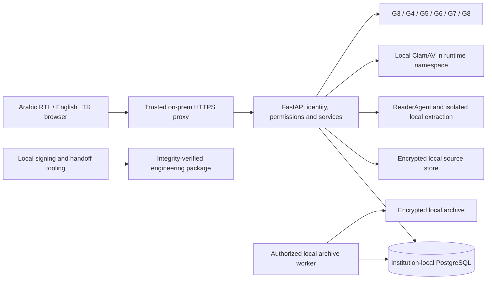
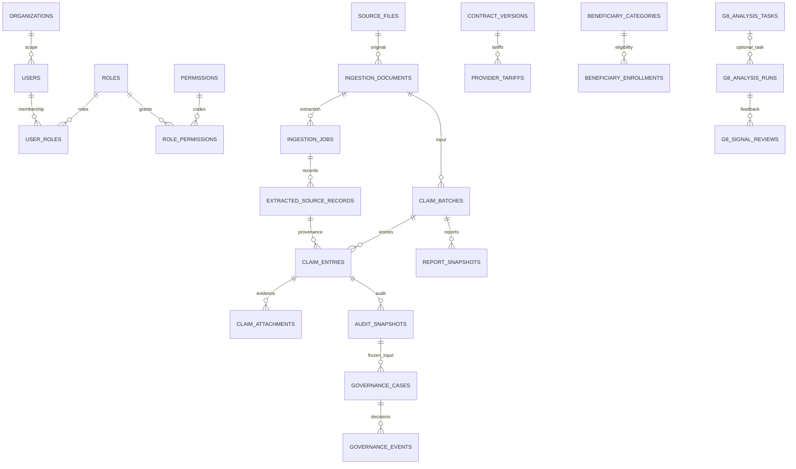
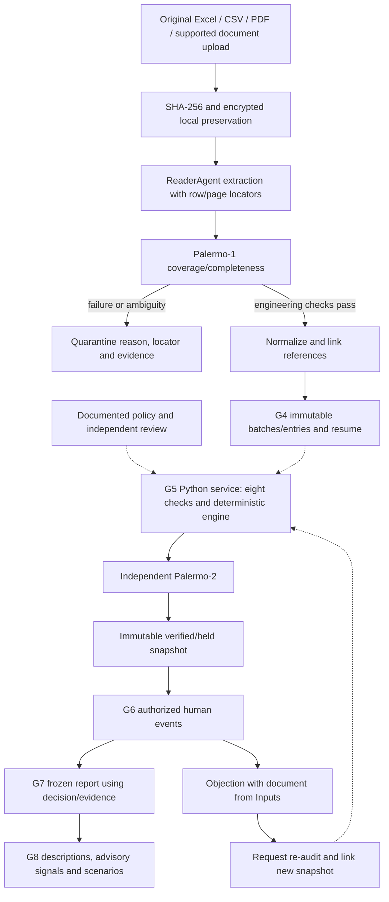

# MCIAS v2.0 — Master design and implementation baseline

Document ID: `MCIAS-DES-001` · Version: 1.0 · Baseline date: 2026-10-10 UTC

Status: **ENGINEERING_BASELINE / PENDING_INSTITUTIONAL_APPROVAL**.

[النسخة العربية](MCIAS_MASTER_DESIGN_BASELINE.md) · [Acceptance pack](ACCEPTANCE_PACK_INDEX_EN.md) · [Binding acceptance contract](ACCEPTANCE_CONTRACT.md)

## Reading map

Sections 1–2: authority/requirements; 3–5: architecture/database/flow; 6–7: audit/permissions; 8–10: interfaces/reports/operations; 11–14: acceptance/completed work/evidence/gaps/change control.

## 1. Scope and authority

This master document consolidates implemented design, requirements, architecture and delivery status. Baseline means the reviewed engineering version integrated on main, not institutional signature on every decision or G0–G9 acceptance. No recorded institutional signature authorizes describing this package as a fully approved production design.

- Repository: [overurdream-collab/test2](https://github.com/overurdream-collab/test2).
- Reference branch: `main`; pinned SHA: `5c8b63a209e4f44a8faaf9a38a05c81d92512dda`.
- Engineering consolidation completed through PR #14; the bilingual handoff pack arrived in merged [PR #15](https://github.com/overurdream-collab/test2/pull/15).
- Specifications describe the pinned SHA. Later changes need their own version/evidence; prior CI cannot certify a new commit.
- Authority order: acceptance contract, institutional signed decisions within their scope, then this baseline and coverage matrix. Code/tests demonstrate engineering behavior. A conflict with a binding requirement is a gap, not an automatic contract amendment.
- Earlier branch/CI references in documents remain historical evidence. Main is current; proposed React/TypeScript ADR-003 does not describe the implemented frontend.

| Term | Meaning here |
|---|---|
| Engineering implemented | Executable code exists, with specific verification evidence where available; no implicit institutional acceptance |
| Partial | Some requirements use real backend contracts; missing capabilities are stated |
| Planned / unavailable | Intentional guidance screen or requirement without an operational API |
| Blocked | Requires missing implementation, data, authorization or acceptance criteria |
| Institutionally approved | Authorized human signature and every contract condition; **no gate is recorded ACCEPTED** |

Baseline approval fields: owner, architecture reviewer, financial owner, privacy officer, policy version, SHA/evidence pack, institution scope, date and signatures. All remain `NOT_RECORDED / NOT_SIGNED` until completed by the institution.

## 2. Purpose and functional requirements

MCIAS is an on-premises system overseeing claims, expenditure, coverage, contracts, evidence, human review and reports. Analysis must be explainable and traceable; it does not issue treatment verdicts, fraud accusations or automatic payments.

| Requirement | Required behavior | Implemented coverage / limit |
|---|---|---|
| Identity/security | Sessions, MFA, RBAC, unauthorized-access denial | Engineering implemented; identity/key authority and external deployment review remain institutional work |
| Sources/ingestion | Encrypted originals, hash, row/page locators and quarantine | ReaderAgent, Palermo-1 and input APIs; institutional OCR accuracy and governed original download incomplete |
| References | Temporal contracts, tariffs, categories and service-date eligibility | Versions and conflict guards; official dictionaries/legal precedence awaiting authority |
| Claims | Batches, resume, attachments, immutable originals | G4 engineering implemented; institution volume/SLA unapproved |
| Financial audit | Eight checks, deterministic engine, Palermo-2 | Engine/snapshots/read evidence; **no production G5 execution API** |
| Governance | Separate duties, objections, evidence, linked re-audit | Immutable G6 events; configurable stages, assignment, escalation and complete appeals absent |
| Reporting | Versioned Excel/PDF and protected beneficiary data | G7 partial; institutional formats/field rights/live reconciliation pending |
| Intelligence | Descriptions, trends, signals and governed tasks | G8 deterministic/advisory; no generative chat or autonomous decision agent |
| Technical administration | Sources/rules/policies/tasks/health/archive | Selected operations work; no comprehensive organization/user/role CRUD |
| Operations/release | Build, verification, restore, documentation/testing | CI/handoff/local tools; institutional deployment, PenTest, UAT and signature unexecuted |

These requirements do not imply every original project feature is complete. Section 8 and the API matrix enumerate intentional screens and limits.

## 3. Architecture and technology

On-premises baseline: **separate installation, PostgreSQL database and source storage per institution**. organizations/organization_id do not create a hosted multi-institution SaaS or automatic database switching. Sensitive records must not be transferred to external services.



This is a component map. TLS, ClamAV, keys and grants require local provisioning; the diagram is not proof of deployment on institutional infrastructure.

| Layer | Engineering reality |
|---|---|
| Backend | Python >=3.11; pinned CI uses 3.12; FastAPI/Uvicorn/Pydantic Settings |
| Data | PostgreSQL 16 in CI; SQLAlchemy 2.x, psycopg 3.x, Alembic 1.x; dependency bounds in pyproject.toml |
| Frontend | Local HTML/CSS/JavaScript ES modules; JSDoc contracts; no implemented React/Vite/TypeScript/Tailwind application |
| Finance | Python Decimal and PostgreSQL NUMERIC; browser never calculates authoritative amounts |
| Files/encryption | Local AES-GCM/SHA-256; openpyxl, pypdf, PyMuPDF, Pillow; locally provisioned OCR |
| Reports | openpyxl/ReportLab, arabic-reshaper/python-bidi and local fonts |
| Verification | pytest/httpx, Node JavaScript tests, Playwright/axe, real PostgreSQL integration |
| Handoff | Wheels/wheelhouse, source archive and integrity receipts; optional engineering Compose, not approved institutional deployment |

[Dependencies](../pyproject.toml) are bounded ranges, not a comprehensive lock file. Approved pinned digests/dependencies and offline packaging remain production prerequisites.

```text
mcias/
  app.py, auth.py, policy.py, tenant.py       server/access boundaries
  models*.py                                database mappings
  ingestion/                                ReaderAgent and Palermo-1
  reference*.py, claims_api.py               references and claims
  audit_*.py, palermo2.py                    G5 authorization/reconciliation
  governance_g6*.py                         human decision history
  reporting_g7*.py, report_*.py              frozen reports
  intelligence*_g8.py                       analysis/review/Studio
  web_workspace/, web_g7/, web_g8/            interfaces/local assets
  seed/, rate_limits.py, retention*.py       fixtures/operational controls
alembic/versions/                            18 sequential migrations
scripts/                                    operation/checks/handoff
tests/, docs/, deploy/                      tests/docs/deployment harness
```

The actual package is root-level mcias/, not an assumed src/mcias/ hierarchy.

## 4. PostgreSQL and reference data model

Current head: **0018_claim_query_indexes**, predecessor **0017_operational_limits**. Importing all models*.py registers **35 application tables in SQLAlchemy metadata**; alembic_version is additional migration bookkeeping. This inventories reference code, not a live client database or real institutional rows. External checks must verify actual schema/head/runtime grants.

| Domain | Reference table names |
|---|---|
| Identity/base governance — 12 | organizations, users, roles, user_roles, permissions, role_permissions, session_tokens, mfa_factors, login_attempts, audit_log, written_authorizations, rule_versions |
| Sources/legacy claims — 2 | source_files, claims |
| Ingestion — 4 | ingestion_documents, ingestion_jobs, extracted_source_records, ingestion_quarantine |
| Reference — 4 | contract_versions, provider_tariffs, beneficiary_categories, beneficiary_enrollments |
| G4 claims — 3 | claim_batches, claim_entries, claim_attachments |
| G5 audit — 2 | audit_policy_grants, audit_snapshots |
| G6 governance — 2 | governance_cases, governance_events |
| G7 reporting — 1 | report_snapshots |
| G8 intelligence — 4 | g8_analysis_tasks, g8_analysis_task_events, g8_analysis_runs, g8_signal_reviews |
| Operations — 1 | api_rate_limit_buckets |

claims is a legacy foundation model; current batch processing uses claim_entries. Neither silently replaces the other. source_files and legacy claims lack direct organization_id; service checks follow governed references instead of assuming every table contains a tenant column.

| Data convention | Implementation/constraint |
|---|---|
| Naming | snake_case tables/fields; singular exceptions include audit_log/ingestion_quarantine; no blanket rename |
| Identifiers | Mostly UUID strings in String(36), not native PostgreSQL UUID everywhere; composite junction and hash/time counter keys |
| Money | claim_entries/provider_tariffs NUMERIC(18,4); legacy claims NUMERIC(18,2); snapshots carry monetary strings in JSON |
| Dates/text | date for service/effectivity, timezone-aware UTC events; UTF-8/Arabic preserved without rewriting originals |
| Evidence | source_values/source_locator, hashes, versions and document links; UUIDs are not proof of correctness |
| Constraints | NOT NULL/FK/UNIQUE/CHECK plus targeted temporal guards/triggers in PostgreSQL migrations; protection varies by table |
| Immutability | Imported claims, attachments, snapshots/events protected in applicable layers; DB owner/superuser can bypass triggers and cannot be the runtime role |
| Status | Many states are service/constraint-controlled strings, not a universal PostgreSQL ENUM; no invented generic claim_status/audit_status/source_type |

G4 entries carry claim_reference, beneficiary_token, provider_code, service_code, service_date, claimed_amount, currency, batch/extraction/evidence references. No complete standardized quantity/tax or clinical/medication dictionary model is supplied. No institution-approved loaded ICD/CPT/LOINC/SNOMED catalog is claimed.



The ER map selects major FKs. G7-to-G8 provenance is recorded in sources/fingerprints, not a direct FK for every JSON item. beneficiary_token is a matching token, not a FK into a centralized personal registry.

0018 adds organization_id/service_date, organization_id/provider_code and organization_id/beneficiary_token indexes on claim_entries. governance_events(case_id,version) already has a unique index; proposed audit/report composites remain deferred without representative workload. The 10K synthetic measurements in [operational controls](OPERATIONAL_CONTROLS.md) are not an approved SLA.

## 5. Data and evidence flow



Dotted arrows identify G5 service integration needed for production execution. No production UI/API generates that snapshot. The test harness creates an explicit synthetic snapshot seam, not institutional execution or approval. This is logical sequencing, not a claim of complete automation.

Traceability chain: original/hash → document/job/manifest → locator/record → claim/batch/attachment → contract/enrollment/policy version → audit snapshot/reconciliation → governance event/version → report snapshot/fingerprint → analysis sources/fingerprints → independent signal review. Missing identifiers/data are never invented to complete it.

Quarantine preserves originals. A new document or authorized change creates a version/link rather than replacing source_values or an old report. Evidence ownership/read rights are checked by the server. The evidence UI displays hashes/manifests/quarantine; governed original-download HTTP API remains unavailable.

## 6. Eight agents and audit rules

The agents in [audit_agents.py](../mcias/audit_agents.py) are deterministic financial/administrative supporting checks, not eight independent LLMs. None issues a final medical/institutional decision. AGENTS display order is different from deduction order.

| Code category | Current purpose | Evidence/limit |
|---|---|---|
| eligibility | Exactly one enrollment effective on service date | enrollment ID; absent/ambiguous means hold |
| tariff | Approved contract service tariff in matching currency | tariff ID; missing/mismatch means hold |
| contract | Effective approved provider contract | contract ID; no assumed legal precedence |
| exclusion | Policy-backed exclusion condition | policy ID; approved flag alone cannot authorize service execution |
| caps | Policy cap | policy ID; not a cumulative annual-cap ledger |
| cost_sharing | Beneficiary contribution | policy ID; approved percentage of remaining balance |
| duplicates | Repeated claim reference within institution | candidate IDs; review, not fraud accusation/automatic deduction |
| evidence | Linked claim attachment | attachment IDs; linkage alone is not full clinical validation |

Each finding carries agent/status/reason/reference. Current agent states are pass/hold/review; UI preserves backend reasons/evidence. Palermo-2 denies verified status for unresolved agents, invalid amounts or source/currency/fingerprint/total mismatches.

[audit_engine.py](../mcias/audit_engine.py) runs only on the server with explicit policy ID/fingerprint, currency, precision, rounding and order:

1. Round money using approved HALF_UP/HALF_EVEN and precision 0/2/4; changes require review.
2. Exclusion is a monetary amount bounded by the remaining balance.
3. tariff is a ceiling on the post-exclusion balance, not a percentage deduction or general unit price.
4. cap optionally limits the remaining amount; no automatic yearly beneficiary accumulation.
5. copay applies to the remaining balance after exclusions/tariff/cap.
6. Deductions plus balance must equal claimed; Palermo-2 independently checks arithmetic/original/fingerprint. A rounding mismatch against original claimed keeps reconciliation held until addressed by approved policy.

Current supported order is fixed exclusion → tariff → cap → copay. No FX, standardized tax/quantity calculation, or AI-added deductions. G5 UI displays claimed, stages, total_deduction/payable returned by the backend. Missing stages are not fabricated zeros; payable=null does not itself reject a claim.

[audit_service.py](../mcias/audit_service.py) checks trusted authorization, active registry, independent reviewers, same institution and matching tariff; revoked grants cannot authorize new execution. Unique claim_id/policy_fingerprint snapshots are immutable. verified is engineering reconciliation, not G6 approval/payment.

The [FIN-ADR pack](policies/POLICY_PACK_EN.md) proposes 13 decisions covering precedence, eligibility, tariff/quantity/tax, exclusion, deduction order, caps, copay, rounding, currency, missing evidence, duplicates, human disposition and retention. All are unsigned; writing them cannot activate a production financial policy.

## 7. Identity, permissions and trust boundaries

- Opaque Bearer sessions store only hashes in session_tokens; current lifetime 30 minutes with logout revocation. Browser token stays in memory.
- PBKDF2-HMAC-SHA256 passwords; mandatory Super Admin TOTP/MFA with replay-counter protection. Local MFA recovery requires two independent signatures; no working public forgot-password API.
- RBAC defaults deny. A role does not implicitly grant everything. Server checks institution/record/field scope; hidden navigation is not security.
- User projections require governed Super Admin server controls and explicit read access; no unrestricted role-grant screen exists.

| Action | Actual permission examples | Additional control |
|---|---|---|
| Context/platform reads | profile.read, users.read | Actual institution; users guarded by Super Admin or dedicated server entitlement |
| Ingestion/read/review | ingestion.upload, ingestion.read | Encrypted original; every raw column needs `medical_fields.<column>.read` before records |
| Reference | reference.read, reference.write, reference.approve | Effective periods/impact/versioning; writing is not institutional policy approval |
| Claims | claims.read, claims.import | Tenant/evidence/resumable import guards |
| Rules | rules.read, rules.activate, rules.exclusions.edit | Written authorization, separate approver, production trust-registry verification |
| Financial policies | policies.approve, policies.review, policies.revoke | Independent identities, institution/policy fingerprint, nonrevoked grant |
| G6 decisions | governance.propose/review/approve/reaudit | Every historical proposer barred from approving/rejecting own case; evidenced objection |
| Reports | reports.read, reports.create, reports.export, reports.originals.export, reports.beneficiary.read | Independent raw-field rights; no generic medical export |
| G8 | intelligence.read/run/review, intelligence.studio.read/manage/test/activate | Run also needs reports.read; independent reviewer, whitelisted source/configuration |
| Retention | retention.read, retention.archive | User's institution; worker rechecks; no purge entitlement/API |

Feature entitlements follow `features.<feature>.use` and default deny; a comprehensive institution-entitlement editor is not implemented.

This is a summary, not a blanket grant recipe. APIs/services define every operation; institutional medical-field access needs approval.

Keep three mechanisms distinct: production rule authorization uses Ed25519 over canonical JSON binding identity/source/content; G5 policy grants use local HMAC-SHA256 with institution/policy/reviewer bindings; release receipts optionally use Ed25519. Technical signature alone is not legal institutional authority. HTTP cannot supply trusted keys; source/MFA/HMAC/signing secrets never reach frontend code.

PostgreSQL runtime cannot own tables or CREATE/CREATEDB/CREATEROLE/REPLICATION/BYPASSRLS, or UPDATE/DELETE audit_log; operations use explicitly reviewed grants. No comprehensive RLS is assumed; end users receive no direct SQL access. CSP/no-store headers, validation and bounded uploads/parsers are engineering controls; independent PenTest remains unexecuted.

## 8. Interfaces and visual system

Two experiences share one application: /admin/ technical administration, /institution/ intelligence/review, /shared/ common screens. /login and /mfa use authentication; /forgot-password provides truthful guidance without a fake reset action. Registry contains **59 workspace routes**, plus three auth routes; / redirects.

The [design system](FRONTEND_DESIGN_SYSTEM.md) uses self-hosted IBM Plex Sans Arabic/Inter, Arabic RTL/right sidebar and English LTR/left sidebar, Light/Dark and logical CSS. Navy #102A43, Blue #2563EB, Teal #0D9488, Sky #38BDF8, background #F5F8FC and AI Violet #7C3AED; small text uses accessible darker variants. Thirteen transparent depth-styled SVG assets, no WebGL/emojis.

Shell includes collapsible navigation, breadcrumbs, module search, actual institution/user context, language/theme and logout. Unsupported notification inbox or institution switching is not shown as operational. Components share loading/empty/error/unauthorized/unavailable states, success feedback, filters/tables/evidence/dialogs and keyboard focus. Mobile drawer traps focus; tables scroll in their own regions without application-wide horizontal overflow.

Institution dashboard uses one selected frozen G7 report with real currency-separated totals. No unsupported savings, period comparisons, synchronization date, active beneficiary count or utilization denominator. Charts expose exact values/evidence; only visual geometry is approximate. Pagination is server-backed; filtering/sorting is explicitly loaded-page-only. No unauthorized client-generated protected export.

### Route inventory at the reference SHA

Every route below has an intentional UI state. Partial does not mean the complete requested feature exists. See the [route/API matrix](FRONTEND_ROUTE_API_MATRIX.md) for actions, APIs and detailed limits.

| Route | Module | Registry coverage |
|---|---|---|
| `/admin/dashboard` | Platform overview | Partial — backend within stated scope |
| `/admin/organizations` | Organizations | Unavailable — intentional guidance |
| `/admin/users` | Users | Partial — backend within stated scope |
| `/admin/roles` | Roles | Unavailable — intentional guidance |
| `/admin/permissions` | Permissions | Partial — backend within stated scope |
| `/admin/security` | Security & MFA | Partial — backend within stated scope |
| `/admin/audit-logs` | Audit & access history | Unavailable — intentional guidance |
| `/admin/data-sources` | Data sources | Partial — backend within stated scope |
| `/admin/ingestion` | Data ingestion | Partial — backend within stated scope |
| `/admin/quarantine` | Quarantine | Partial — backend within stated scope |
| `/admin/reference-data` | Reference governance | Partial — backend within stated scope |
| `/admin/financial-policies` | Financial policies | Partial — backend within stated scope |
| `/admin/policy-approvals` | Policy approvals | Partial — backend within stated scope |
| `/admin/ai-agents` | Agent governance | Partial — backend within stated scope |
| `/admin/analysis-tasks` | Analysis tasks | Partial — backend within stated scope |
| `/admin/rules` | Rules | Partial — backend within stated scope |
| `/admin/indicators` | Indicators | Partial — backend within stated scope |
| `/admin/thresholds` | Thresholds | Partial — backend within stated scope |
| `/admin/workflows` | Workflow configuration | Unavailable — intentional guidance |
| `/admin/integrations` | Integrations | Unavailable — intentional guidance |
| `/admin/system-health` | System health | Partial — backend within stated scope |
| `/admin/backups` | Backup & restore | Partial — backend within stated scope |
| `/admin/alerts` | Alerts | Unavailable — intentional guidance |
| `/admin/settings` | Platform settings | Partial — backend within stated scope |
| `/institution/dashboard` | Executive overview | Partial — backend within stated scope |
| `/institution/claims` | Medical claims | Partial — backend within stated scope |
| `/institution/claims/batches` | Claim batches | Partial — backend within stated scope |
| `/institution/beneficiaries` | Beneficiaries | Partial — backend within stated scope |
| `/institution/providers` | Healthcare providers | Partial — backend within stated scope |
| `/institution/hospitals` | Hospitals | Unavailable — intentional guidance |
| `/institution/laboratories` | Laboratories | Unavailable — intentional guidance |
| `/institution/pharmacies` | Pharmacies | Unavailable — intentional guidance |
| `/institution/medications` | Medications | Unavailable — intentional guidance |
| `/institution/procedures` | Tests & procedures | Unavailable — intentional guidance |
| `/institution/utilization` | Healthcare utilization | Partial — backend within stated scope |
| `/institution/insurer-billing` | Insurer reconciliation | Unavailable — intentional guidance |
| `/institution/financial-audit` | Financial audit | Partial — backend within stated scope |
| `/institution/duplicates` | Duplicate indicators | Partial — backend within stated scope |
| `/institution/anomalies` | Review signals | Partial — backend within stated scope |
| `/institution/waste-analysis` | Potential waste | Unavailable — intentional guidance |
| `/institution/contract-gaps` | Contract gaps | Partial — backend within stated scope |
| `/institution/cost-optimization` | Cost scenarios | Partial — backend within stated scope |
| `/institution/quality` | Quality & service | Unavailable — intentional guidance |
| `/institution/trends` | Time & geographic trends | Partial — backend within stated scope |
| `/institution/evidence` | Evidence center | Partial — backend within stated scope |
| `/institution/reviews` | Human review | Partial — backend within stated scope |
| `/institution/appeals` | Objections & appeals | Partial — backend within stated scope |
| `/institution/ai-intelligence` | AI intelligence | Partial — backend within stated scope |
| `/institution/alerts` | Alerts & recommendations | Partial — backend within stated scope |
| `/institution/reports` | Executive reports | Partial — backend within stated scope |
| `/institution/settings` | Institution settings | Partial — backend within stated scope |
| `/shared/profile` | My profile | Partial — backend within stated scope |
| `/shared/notifications` | Notifications | Unavailable — intentional guidance |
| `/shared/help` | Help & guidance | Partial — backend within stated scope |
| `/admin/organizations/:id` | Organization details | Unavailable — intentional guidance |
| `/admin/users/:id` | User details | Partial — backend within stated scope |
| `/institution/claims/:id` | Claim details | Partial — backend within stated scope |
| `/institution/beneficiaries/:id` | Beneficiary eligibility | Partial — backend within stated scope |
| `/institution/providers/:id` | Provider details | Partial — backend within stated scope |

## 9. Governance, reports and intelligence

G6 appends propose/hold/approve/reject/object/request_reaudit/link_reaudit events against a frozen G5 snapshot. approve requires verification and historical proposer separation. object needs a verified Inputs document; re-audit request does not execute G5 automatically. Configurable stages, assignment/escalation, medical free text and complete appeals are absent.

G7 freezes a batch report version with originals, snapshot IDs, G6 disposition, fingerprint and per-currency totals. Held/objected/unverified items do not enter approved payable; claimed and approved payable remain separate. Excel/PDF are server exports; beneficiary statements and original fields require permissions. Re-audit/change creates a new report snapshot, never rewrites an older report.

G8 reads only frozen G7 reports, verifies G4 integrity/reconciliation/source reports, and groups by provider/service/month. Groups smaller than five are suppressed/combined; this alone is not blanket privacy acceptance. False-positive proportion uses actually reviewed signals, not true fraud prevalence.

Studio versions exactly source/indicator/dimension/threshold_percent/min_group_size, with server testing and a different activation reviewer. Source is g7_frozen_report_snapshots; no arbitrary SQL/code/prompts/external URLs. Up to 12 distinct-batch reports and 10,000 claims are engineering safeguards, not signed workload limits. No scheduler, generative chat or autonomous financial/medical execution.

## 10. Operations, synthetic data and handoff

| Control | Implemented | Limit/pending decision |
|---|---|---|
| Quotas | Atomic PostgreSQL: 100/user/minute, 1000/IP/minute, 429/Retry-After, fail-closed 503 | Fixed UTC windows, not rolling; login/logout/health exempt, separate login lockout; explicit proxy trust |
| Seed | One versioned dataset, UUIDv5/hash/receipt/idempotence, dev/*_e2e only | No public seed API; private output contains test credentials; some source fixtures metadata-only |
| Synthetic separation | Separate DB/storage, labeled demo and new SYN- public references | No universal source_type/backfill; no UUID/all-old-fixture rename; production starts fresh |
| Archives | Monthly tenant-scoped requests/local worker, AES-GCM/readback/hash receipts | No S3/partition conversion/purge/legal-hold registry; seven years unsigned; 10K rows/128MiB; null-actor excluded |
| Backup/restore | Encrypted tools and synthetic pg_dump/pg_restore/source recovery tests | Audit archive is not full backup; institutional restore/key custody/RPO/RTO require acceptance |
| Deployment/checks | Wheelhouse/source receipts, optional signature, deploy_check.sh | Independently expected SHA, read-only/query timeout, TLS/health; not acceptance; Compose needs local ClamAV/digests/grants/keys |

Originals/snapshots remain immutable; deletion cannot bypass history or hide objections. Explicit seed reset destroys only a dedicated *_e2e DB and is not production deletion policy. Institutional installation starts with clean DB/storage and never inherits test credentials/keys.

[Deployment](DEPLOYMENT_GUIDE_EN.md), [external test plan](EXTERNAL_TEST_PLAN_EN.md), [report template](EXTERNAL_TEST_REPORT_TEMPLATE_EN.md), [UAT plan](UAT_PLAN_EN.md), [scenarios](UAT_SCENARIOS_EN.md), [checklist](UAT_CHECKLIST_EN.md), [penetration plan](PENETRATION_TEST_PLAN_EN.md) and [scope](PENETRATION_TEST_SCOPE_EN.md) are review-ready drafts. External results remain NOT_EXECUTED and signatures NOT_SIGNED; UAT-25 is blocked by absent production G5 execution.

## 11. G0–G9 acceptance and status

This summarizes, never replaces, the acceptance contract. Every gate remains **OPEN / NOT_ACCEPTED**. Engineering across stages does not waive sequential institutional acceptance.

| Gate | Contract scope/tests | Available engineering | Missing acceptance |
|---|---|---|---|
| G0 | Readiness, architecture, threats, ADRs/policies | Setup/environment/docs/13 proposed FIN-ADRs | Signed readiness, architecture/policy/field/OCR/volume/SLA decisions |
| G1 | Identity/MFA/RBAC/immutability/encryption/restore; T06/T07/T11/T17 | Services/guards/CI/synthetic restore | Authority/key custody, TLS/restricted runtime, independent recovery/security sign-off |
| G2 | ReaderAgent/Palermo-1; T01–T03 and coverage | Originals/hashes/quarantine/locators/tests | Institutional input inventory, agreed OCR accuracy/human verification/sign-off |
| G3 | Temporal contracts/tariffs/eligibility; T04–T05 | Versions/conflict guards/impact/authorization | Legal precedence, actual tariffs/official references/institution signature |
| G4 | Batches/evidence/resume; T09/T16 and volume | Line-level import/resume/dedup/immutable originals | Representative volume/invoice linkage/UAT/SLA |
| G5 | Eight agents/engine/Palermo-2; T08/T09 | Deterministic calculation/snapshots/evidence/registry | Signed policy/golden independent reconciliation/governed production execution API |
| G6 | Approvals/objections/re-audit; T10–T12 | Immutable events/separate duties/linkage | Institutional stages/authority and complete signed appeals/re-audit workflow |
| G7 | Frozen reports/statements; T13/T18/T20 | Arabic Excel/PDF/snapshots/privacy | Signed formats/field rights, independent reconciliation, volume/institution UX |
| G8 | Analysis/signals/Studio; T14/T15/T19 | Advisory description/signals/simulation/task tests | Labeled data/false-positive evaluation/true denominators/approved thresholds/UAT |
| G9 | Security/performance/recovery/handoff/training/all regression | Checks/receipts/build/CI/test evidence | Independent PenTest, actual SLA, full target-hardware restore, pinned pack/release signature |

Shared exit conditions: executable end-to-end demonstration, requirement/negative/prior-stage regression on the same SHA, security/privacy/integrity and critical issue closure, command/environment/fixture/time/outcome/URL/reviewer evidence, authorized human signature. Never set ACCEPTED before all conditions. [Gate register](../GATE_STATUS.md) and [G0–G9 tracker](G0_G9_ACCEPTANCE_TRACKER.md) retain institutional decisions; historical notes cannot supersede the contract.

## 12. Completed work and pinned evidence

Main integrates G1–G8 backend, G9 tools, operational controls and both interfaces with the limits stated here. Delivered bilingual design system, 13 icons, intentional route states, theme/responsiveness, evidence views, available backend integrations and governed forms. Quotas, safe seed, local archive, claim indexes, 11 paired handoff documents/two indexes/checker shipped; PR #15 merged the bilingual pack.

### Verified CI at 5c8b63a209e4f44a8faaf9a38a05c81d92512dda

| Workflow | Run/outcome |
|---|---|
| G1–G7 | [38091229475](https://github.com/overurdream-collab/test2/actions/runs/38091229475) — SUCCESS |
| G8 | [38091229490](https://github.com/overurdream-collab/test2/actions/runs/38091229490) — SUCCESS |
| G9 | [38091229481](https://github.com/overurdream-collab/test2/actions/runs/38091229481) — SUCCESS |
| Enterprise | [38091229496](https://github.com/overurdream-collab/test2/actions/runs/38091229496) — SUCCESS |

Four workflows/eight jobs passed. Enterprise recorded **357 Python passed, one skipped (run separately and passed as the dedicated Seed test), 14 warnings; 10 JavaScript passed; browser/responsive/WCAG checks passed across 59 routes and dynamic record states**. Never sum duplicate tests across workflows. Synthetic tests/build/browser checks are engineering verification, not an external assessment, security certificate or institutional signature.

Historical evidence/previews: [browser](evidence/integrated/browser-results.json), [integrated flow](evidence/integrated/workflow-results.json), [index measurements](evidence/operational/index-benchmark.json), [Arabic archive screenshot](evidence/operational/retention-ar.png). These artifacts retain their earlier context and cannot independently certify acceptance on a later SHA. Exact CI logs are authoritative for a specific run's outcome.

## 13. Gaps and next actions

| Track | Next action | Authority/evidence |
|---|---|---|
| Institutional decisions | Review/sign FIN-ADRs, financial policy, delegation, retention and field access | Finance/legal/privacy/organization head; documents/hashes/effectivity |
| Dependent engineering | Translate approved choices into requirements; governed G5 API and required stages/appeals/specialized data | Engineering/independent review; no premature financial activation |
| Data | Authorized contracts/tariffs/beneficiaries/claims/dictionaries and golden dataset | Data owner; local minimized transfer/validation/reconciliation |
| Environment | Pin SHA, DB roles, TLS/keys/ClamAV/full backups and deployment checks | Operations/security; real target results, not CI alone |
| Acceptance | EXTERNAL_TEST, UAT/PenTest, fixes/retests and per-gate acceptance | QA/independent tester/authorized approver; contract evidence/signatures |

Documents and a synthetic environment can be prepared now. Penetration work needs a signed scope; real-data/financial work needs explicit authority and approved policy. Visual completeness/main merge cannot grant operational approval.

## 14. Baseline change control

Change this reference, API matrix and dependent documents in the same PR when schema/API/calculation/permission/route/operational limits change. Pin a new baseline SHA, verification evidence and policy-impact review. Preserve historical CI; never infer NOT_SIGNED fields as accepted. Institutional decisions have separate versions, signatures and effectivity from engineering releases.

| Version | Date | Change | Approval |
|---|---|---|---|
| 1.0 | 2026-10-10 | Consolidated design/requirements/architecture/code/evidence at main 5c8b63a209e4f44a8faaf9a38a05c81d92512dda | Engineering reference; institutional signature pending |
