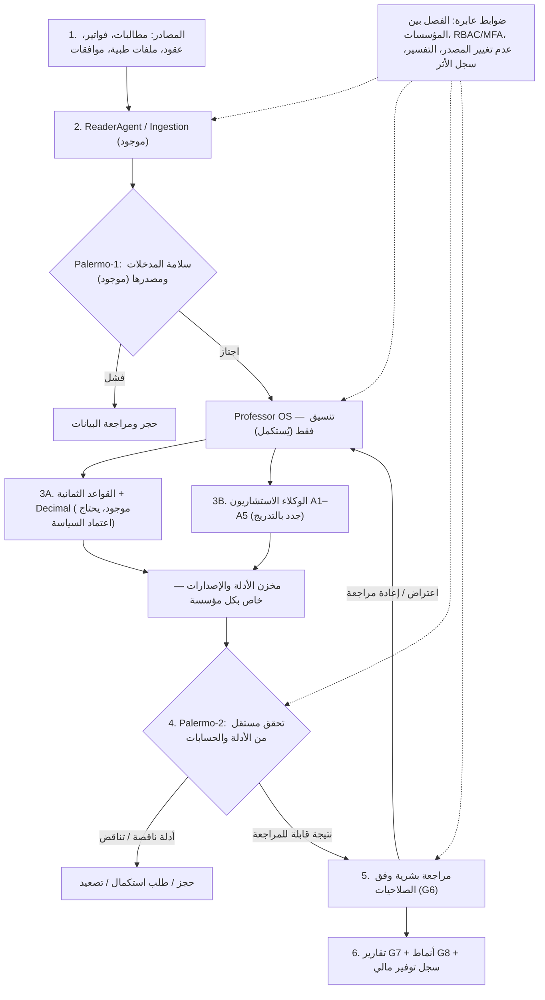

# MCIAS v2.0 — المخطط المرجعي للوكلاء ومسار البناء
**الحالة:** مسودة معمارية للمراجعة والاعتماد — ليست تفويضًا بنشر أي نموذج أو تشغيله على بيانات حقيقية.  
**التاريخ:** 2026-10-17  
**المستودع الأساسي:** `overurdream-collab/test2`، فرع `main`، المرجع المفحوص `b69defa2f621458ef44d790b510840307a81009a`  
**المرجع الوظيفي الأعلى:** المخطط المعتمد MCIAS v2.0 ذو ست مراحل في مناقشة المشروع.
**الغرض:** مصدر واحد لتصميم أدوار الوكلاء ومسار تجهيزها والتحقق من قبولها. وثائق سياسة المؤسسة والموافقات الأمنية والمالية الموقعة لها الأولوية في اختصاصها، ولا تُستبدل بهذا الملف.

## 1) المبادئ الثابتة
1. لا إعادة بناء النظام: الحفاظ على ReaderAgent وPalermo-1 والفاحصين الثمانية ومحرك Decimal وPalermo-2 ومسارات G6/G7/G8 وPostgreSQL.
2. Professor OS **منسق فقط**: اختيار المهمة، جدولة الوكلاء، حفظ نسخ المدخلات والتتبع، تجميع مقترحاتهم؛ لا خصم، لا اعتماد ولا حكم سريري.
3. فصل واضح بين: **قواعد حتمية** و**محركات تعلم آلي/نماذج لغوية استشارية** و**تحقق مستقل** و**قرار بشري**.
4. كل استنتاج له مصدر/موضع/نسخة قاعدة أو نموذج؛ وإلا يكون `INSUFFICIENT_EVIDENCE` وليس مخالفة مؤكدة.
5. ممنوع الإرسال الخارجي لبيانات المرضى أو نقل بيانات بين المؤسسات. استخدام السحابة المجانية محصور ببيانات اصطناعية.
6. السجلات الأصلية لا تتغير؛ التاريخ والاعتراض وإعادة التدقيق نسخ مؤرخة وقابلة للتتبع؛ لا خصم مضاعف أو وفورات مكررة.
7. الحجز/التنبيه لا يساوي رفضًا أو اتهامًا؛ الموافقة المالية والطبية النهائية للبشر المخولين وفق سياسة المؤسسة.
8. تبقى جميع بوابات قبول G0–G9 **OPEN** حتى أدلة اختبار وموافقة بشرية رسمية. نجاح CI لا يعني قبولًا مؤسسيًا.

## 2) مخطط تدفق التنفيذ النهائي

> Palermo-2 موجود اليوم للتحقق الحتمي المالي؛ توسيع التحقق إلى مخرجات AI مهمة مستقبلية. لا يكتفي بترديد رأي النموذج الذي أنتج الإشارة.

## 3) سجل الأدوار — الموجود والمقترح

| ID | المكوّن | المسؤولية المحددة | النوع | الحالة عند مراجعة main |
|---|---|---|---|---|
| K0 | Professor OS | ينسق، يشغل إجراءات الاختبار، يدير المهام والأدلة والإصدارات؛ لا يصدر أحكامًا | Orchestrator | المنظومة المستقلة المطلوبة غير مثبتة |
| D0 | ReaderAgent + Ingestion | قراءة CSV/XLSX/PDF والصور، OCR، التطبيع، إظهار عدم اليقين، المصدر والحجر | Deterministic service | موجود كأساس |
| V1 | Palermo-1 | التحقق من المدخلات، وجود المصدر، المطابقة والسلامة قبل أي تدقيق | Independent gate | موجود كأساس |
| B1–B8 | 8 Audit Checkers | الأهلية، العقد، التعرفة، الاستثناءات، السقوف، التحمل، التكرار المرجعي، المرفقات | Deterministic rules | موجود برمجيًا؛ يحتاج بيانات وسياسات وقبول |
| F0 | Decimal Financial Engine | حسابات مالية بإصدارات سياسات معتمدة، وضبط عدم تكرار الخصم | Deterministic financial service | موجود كأساس |
| A1 | InvoiceIntegrity Agent | كشف رسوم زائدة أو بنود مخفية أو كميات مبالغ فيها بالرجوع للعقد والفاتورة والمرفقات | AI-advisory + rules | جديد |
| A2 | CodingIntegrity Agent | اكتشاف إشارات Upcoding وUnbundling وترميز الإجراءات غير المنسجم مع المراجع المصرح بها | AI-advisory + code rules | جديد |
| A3 | DuplicatePattern Agent | العثور على التكرار شبه المتطابق وعبر الفواتير والدفعات مع منع الالتباس بين الخدمات المشروعة | Matching / ML / rules | جديد، امتداد B7 |
| A4 | ClinicalConsistency Agent | فحص تناسق التشخيص والعلاج والفحوصات والتنويم؛ طلب مراجعة سريرية عند الشك | Medical AI-advisory + approved references | جديد، لا حكم سريري نهائي |
| A5 | NetworkAnomaly Agent | اكتشاف شبكات/أنماط شاذة عبر مقدم الخدمة والطبيب والإجراء والزمن مع تفسيرات إحصائية | Graph + ML/statistical | جديد، امتداد G8 |
| V2 | Palermo-2 | إعادة التحقق المستقل من الأرقام والمصادر/الإصدارات؛ حجز الإشارات المتعارضة | Independent gate | تحقق مالي موجود؛ توسيع AI جديد |
| L1 | SavingsLedger | فصل مشبوه/معترض عليه/معدل معتمد/مسترد أو موفَّر فعليًا، دون عد مزدوج | Deterministic financial ledger | جديد/توسيع التقارير، وليس LLM |
| H0 | Human Review | قرار بشري موثق، اعتراض، إعادة التدقيق، الفصل بين المهام | Workflow G6 | أساس موجود، يحتاج اعتماد |
| T0 | Reporting / Intelligence | مخرجات المخالفات والمؤشرات والوفورات عبر G7/G8 | Deterministic reports | موجود جزئيًا، بحاجة توصيل الوظائف الجديدة |

**ملاحظة:** كل `Agent` في التصميم هو دور منطقي محدد؛ ليس بالضرورة نموذجًا مختلفًا أو عملية GPU دائمة. يسمح `Model Gateway` باستخدام نموذج واحد لعدة أدوار مع تعليمات/مراجع/اختبارات مستقلة.

## 4) التسلسل الإلزامي لبناء كل وكيل على حدة

| الترتيب | التسليم | شرط الانتهاء قبل التالي |
|---|---|---|
| S0 | تجميد خط الأساس: مقارنة الشيفرة، بيانات اختبار اصطناعية، عينات مرجعية، تقييم أمن النموذج، سجل فجوات | اختبار مرجعي محفوظ، منع PHI عن الخدمات الخارجية، توثيق أداء النظام الحالي |
| S1 | تجهيز K0/Model Gateway وEvidence Contract دون أحكام؛ تأهيل D0 وV1 وB1–B8/F0 | قبول اختبارات المصدر والحسابات وعدم التكرار، وتشغيل وضع اختبار دون تعديل قرارات مالية |
| S2 | A1 InvoiceIntegrity | بنود فاتورة مرجعية: كشف، تفسير، مقارنة بمحرك القواعد، قياس false positives؛ لا كتابة خصم |
| S3 | A2 CodingIntegrity | مراجع ترميز طبية معتمدة ومرخصة وإصداراتها، اختبارات Upcoding/Unbundling وبدائل سليمة |
| S4 | A3 DuplicatePattern | اختبارات عبر دفعات وتواريخ ومقدمين، منع تكرار التنبيه/الخصم، إثبات دقة المطابقة |
| S5 | A4 ClinicalConsistency | مراجعة أطباء مختصين للـgold set، قياس الحساسية/الأخطاء، منع الاستنتاج السريري النهائي |
| S6 | A5 NetworkAnomaly | مقارنات مُعايرة بالمجموعات، شروح قابلة للفحص، اختبار الانحياز وخطر الإشارات الكاذبة |
| S7 | L1 SavingsLedger | مصالحة مالية مستقلة، وربط القرارات والمبالغ المحققة والمستردة، ومنع العد المزدوج |
| S8 | توسيع Palermo-2 + تكامل G6/G7/G8 واختبار النظام الكامل | اختبارات أمن وعزل وحمل واعتراض وإعادة تدقيق؛ توقيع بشري رسمي قبل الإنتاج |

**قاعدة المرور:** لا يبدأ نشر وكيل جديد بوصفه معتمدًا قبل إغلاق قبول الوكيل السابق. يمكن إعداد وثائق واختبارات الوكلاء اللاحقين بالتوازي دون تفعيلهم.

## 5) عقد النتيجة الموحد لكل وكيل

كل نتيجة استشارية تحتوي على الحقول الأساسية التالية (تُصمم وتُختبر أنواعها قبل البرمجة):
- `tenant_id`, `run_id`, `claim_id`, `line_item_id` عند وجوده.
- `agent_id`, `agent_version`, `model_id`, `model_version`, `ruleset_version`.
- `finding_type`, `finding_status` = `PASS | REVIEW | INSUFFICIENT_EVIDENCE | HELD`.
- `explanation`, `evidence_refs` (مصدر، موضع، بصمة، إصدار)، `missing_evidence`.
- `risk_tier`, `confidence` **فقط بعد معايرة موثقة**، `human_review_required`.
- `suspected_amount` إن كان مناسبًا **مؤشر غير معتمد وليس خصمًا أو توفيرًا محققًا**.
- `input_fingerprint`, `output_fingerprint`, `policy_version`, `created_at`.

الرفض/الاعتماد، المبلغ النهائي والوفورات المعترف بها لا ينتجها الوكيل AI؛ تمر عبر السياسة المالية والتحقق المستقل والإجراءات البشرية.

## 6) مختبر تقييم نماذج MCIAS
- بيانات اصطناعية أولًا؛ عينات موجبة/سالبة/حدية ومطالبات مشروعة مشابهة للاشتباه. بيانات مرضى حقيقية لا تُستخدم حتى تصريح مؤسسي وضوابط محلية.
- يقارن كل وكيل بخط الأساس الحالي، ومرجع صادر عن مختصين، وليس بمخرجات نموذج آخر فقط.
- المقاييس: Precision، Recall، FP/FN، نسبة الدليل الصحيح، المعدل المالي الصحيح، زمن/ذاكرة/كلفة 1000 مطالبة، الاستقرار عبر إعادة الاختبار.
- اختبار الخصوصية وعدم تسرب البيانات، محاولات حقن التعليمات، عزل المؤسسات، رفض المعلومات المجهولة؛ لا قبول بالنظر إلى درجات Benchmark تسويقية.
- المرشحان المبدئيان للاختبار فقط: Qwen3-8B للوثائق/العقود وMedGemma 4B للسجلات الطبية؛ القرار النهائي طبقًا للدقة والترخيص والعتاد.
- Kaggle/Colab للبيانات الاصطناعية فقط. لا خدمات مدفوعة دون موافقة جديدة وصريحة.

## 7) إدارة المصدر المرجعي والتغيير
1. هذا الملف هو **مصدر الحقيقة الوحيد لمسؤوليات الوكلاء وترتيب مراحل تطويرهم** بعد اعتماده ودمجه في `main`.
2. المخطط الوظيفي المعتمد للمراحل الست يبقى ثابتًا؛ أي تعديل معماري مؤثر يمر بسجل ADR مع التبرير والتأثير وموافقة المستخدم.
3. لكل وكيل مستقبلي: مواصفة `docs/agents/<AGENT_ID>.md` تضم المدخلات/المخرجات/الأدلة/التهديدات/حالات الاختبار/بوابة القبول.
4. يُسجّل تقدم التنفيذ منفصلًا عن هذه الوثيقة: `PLANNED | IN_PROGRESS | TESTED_SYNTHETIC | INSTITUTION_ACCEPTED` مع SHA واختبارات وروابط CI وأسماء المُعتمدين.
5. لا يُعدل `main` آليًا بسبب هذه المسودة؛ قبول المخطط ومراجعته يسبقان التنفيذ. قرارات الأسعار والخصم والمراجع السريرية والخصوصية اختصاص سياسات المؤسسة الموقعة وليست افتراضات برنامجية.

## 8) المطلوب من أول تذكرة تنفيذ بعد اعتماد هذا المخطط
تنفيذ **S0 فقط**: إجراء جرد حقيقي لوظائف main، إنشاء هيكل `model-evaluation` محلي ومجموعة بيانات اصطناعية، تثبيت معايير المقارنة وقالب الأدلة، ثم رفع نتائج خط الأساس وقرار المرور إلى S1. لا تحميل نموذج إلى الإنتاج، ولا مدفوعات، ولا بيانات مرضى.
