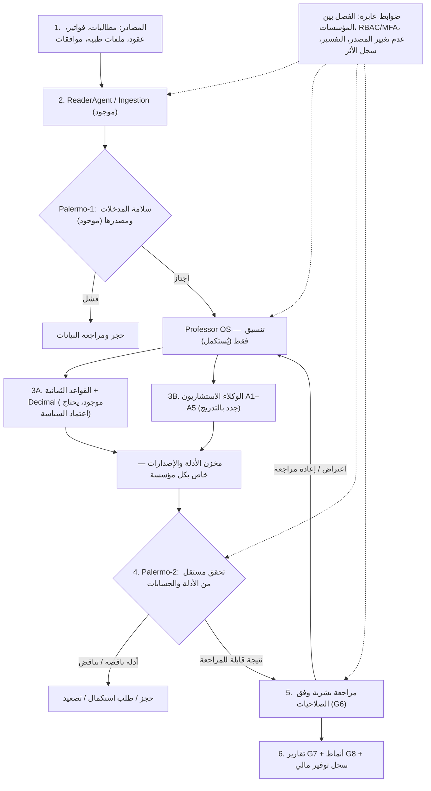

# MCIAS v2.0 — المخطط المرجعي للوكلاء ومسار البناء
**الحالة:** مسودة معمارية للمراجعة والاعتماد — ليست تفويضًا بنشر أي نموذج أو تشغيله على بيانات حقيقية.  
**التاريخ:** 2026-10-17  
**المستودع الأساسي:** `overurdream-collab/test2`، فرع `main`، المرجع المفحوص `b69defa2f621458ef44d790b510840307a81009a`  
**المرجع الوظيفي الأعلى:** المخطط المعتمد MCIAS v2.0 ذو ست مراحل في مناقشة المشروع.
**الغرض:** مصدر واحد لتصميم أدوار الوكلاء ومسار تجهيزها والتحقق من قبولها. وثائق سياسة المؤسسة والموافقات الأمنية والمالية الموقعة لها الأولوية في اختصاصها، ولا تُستبدل بهذا الملف.

## 1) المبادئ الثابتة
1. لا إعادة بناء النظام: الحفاظ على ReaderAgent وPalermo-1 والفاحصين الثمانية ومحرك Decimal وPalermo-2 ومسارات G6/G7/G8 وPostgreSQL.
2. Professor OS **منسق فقط**: اختيار المهمة، جدولة الوكلاء، حفظ نسخ المدخلات والتتبع، تجميع مقترحاتهم؛ لا خصم، لا اعتماد ولا حكم سريري.
3. فصل واضح بين: **قواعد حتمية** و**محركات تعلم آلي/نماذج لغوية استشارية** و**تحقق مستقل** و**قرار بشري**.
4. كل استنتاج له مصدر/موضع/نسخة قاعدة أو نموذج؛ وإلا يكون `INSUFFICIENT_EVIDENCE` وليس مخالفة مؤكدة.
5. ممنوع الإرسال الخارجي لبيانات المرضى أو نقل بيانات بين المؤسسات. استخدام السحابة المجانية محصور ببيانات اصطناعية.
6. السجلات الأصلية لا تتغير؛ التاريخ والاعتراض وإعادة التدقيق نسخ مؤرخة وقابلة للتتبع؛ لا خصم مضاعف أو وفورات مكررة.
7. الحجز/التنبيه لا يساوي رفضًا أو اتهامًا؛ الموافقة المالية والطبية النهائية للبشر المخولين وفق سياسة المؤسسة.
8. تبقى جميع بوابات قبول G0–G9 **OPEN** حتى أدلة اختبار وموافقة بشرية رسمية. نجاح CI لا يعني قبولًا مؤسسيًا.

## 2) مخطط تدفق التنفيذ النهائي

> Palermo-2 موجود اليوم للتحقق الحتمي المالي؛ توسيع التحقق إلى مخرجات AI مهمة مستقبلية. لا يكتفي بترديد رأي النموذج الذي أنتج الإشارة.

## 3) سجل الأدوار — الموجود والمقترح

| ID | المكوّن | المسؤولية المحددة | النوع | الحالة عند مراجعة main |
|---|---|---|---|---|
| K0 | Professor OS | ينسق، يشغل إجراءات الاختبار، يدير المهام والأدلة والإصدارات؛ لا يصدر أحكامًا | Orchestrator | المنظومة المستقلة المطلوبة غير مثبتة |
| D0 | ReaderAgent + Ingestion | قراءة CSV/XLSX/PDF والصور، OCR، التطبيع، إظهار عدم اليقين، المصدر والحجر | Deterministic service | موجود كأساس |
| V1 | Palermo-1 | التحقق من المدخلات، وجود المصدر، المطابقة والسلامة قبل أي تدقيق | Independent gate | موجود كأساس |
| B1–B8 | 8 Audit Checkers | الأهلية، العقد، التعرفة، الاستثناءات، السقوف، التحمل، التكرار المرجعي، المرفقات | Deterministic rules | موجود برمجيًا؛ يحتاج بيانات وسياسات وقبول |
| F0 | Decimal Financial Engine | حسابات مالية بإصدارات سياسات معتمدة، وضبط عدم تكرار الخصم | Deterministic financial service | موجود كأساس |
| A1 | InvoiceIntegrity Agent | كشف رسوم زائدة أو بنود مخفية أو كميات مبالغ فيها بالرجوع للعقد والفاتورة والمرفقات | AI-advisory + rules | جديد |
| A2 | CodingIntegrity Agent | اكتشاف إشارات Upcoding وUnbundling وترميز الإجراءات غير المنسجم مع المراجع المصرح بها | AI-advisory + code rules | جديد |
| A3 | DuplicatePattern Agent | العثور على التكرار شبه المتطابق وعبر الفواتير والدفعات مع منع الالتباس بين الخدمات المشروعة | Matching / ML / rules | جديد، امتداد B7 |
| A4 | ClinicalConsistency Agent | فحص تناسق التشخيص والعلاج والفحوصات والتنويم؛ طلب مراجعة سريرية عند الشك | Medical AI-advisory + approved references | جديد، لا حكم سريري نهائي |
| A5 | NetworkAnomaly Agent | اكتشاف شبكات/أنماط شاذة عبر مقدم الخدمة والطبيب والإجراء والزمن مع تفسيرات إحصائية | Graph + ML/statistical | جديد، امتداد G8 |
| V2 | Palermo-2 | إعادة التحقق المستقل من الأرقام والمصادر/الإصدارات؛ حجز الإشارات المتعارضة | Independent gate | تحقق مالي موجود؛ توسيع AI جديد |
| L1 | SavingsLedger | فصل مشبوه/معترض عليه/معدل معتمد/مسترد أو موفَّر فعليًا، دون عد مزدوج | Deterministic financial ledger | جديد/توسيع التقارير، وليس LLM |
| H0 | Human Review | قرار بشري موثق، اعتراض، إعادة التدقيق، الفصل بين المهام | Workflow G6 | أساس موجود، يحتاج اعتماد |
| T0 | Reporting / Intelligence | مخرجات المخالفات والمؤشرات والوفورات عبر G7/G8 | Deterministic reports | موجود جزئيًا، بحاجة توصيل الوظائف الجديدة |

**ملاحظة:** كل `Agent` في التصميم هو دور منطقي محدد؛ ليس بالضرورة نموذجًا مختلفًا أو عملية GPU دائمة. يسمح `Model Gateway` باستخدام نموذج واحد لعدة أدوار مع تعليمات/مراجع/اختبارات مستقلة.

## 4) التسلسل الإلزامي لبناء كل وكيل على حدة

| الترتيب | التسليم | شرط الانتهاء قبل التالي |
|---|---|---|
| S0 | تجميد خط الأساس: مقارنة الشيفرة، بيانات اختبار اصطناعية، عينات مرجعية، تقييم أمن النموذج، سجل فجوات | اختبار مرجعي محفوظ، منع PHI عن الخدمات الخارجية، توثيق أداء النظام الحالي |
| S1 | تجهيز K0/Model Gateway وEvidence Contract دون أحكام؛ تأهيل D0 وV1 وB1–B8/F0 | قبول اختبارات المصدر والحسابات وعدم التكرار، وتشغيل وضع اختبار دون تعديل قرارات مالية |
| S2 | A1 InvoiceIntegrity | بنود فاتورة مرجعية: كشف، تفسير، مقارنة بمحرك القواعد، قياس false positives؛ لا كتابة خصم |
| S3 | A2 CodingIntegrity | مراجع ترميز طبية معتمدة ومرخصة وإصداراتها، اختبارات Upcoding/Unbundling وبدائل سليمة |
| S4 | A3 DuplicatePattern | اختبارات عبر دفعات وتواريخ ومقدمين، منع تكرار التنبيه/الخصم، إثبات دقة المطابقة |
| S5 | A4 ClinicalConsistency | مراجعة أطباء مختصين للـgold set، قياس الحساسية/الأخطاء، منع الاستنتاج السريري النهائي |
| S6 | A5 NetworkAnomaly | مقارنات مُعايرة بالمجموعات، شروح قابلة للفحص، اختبار الانحياز وخطر الإشارات الكاذبة |
| S7 | L1 SavingsLedger | مصالحة مالية مستقلة، وربط القرارات والمبالغ المحققة والمستردة، ومنع العد المزدوج |
| S8 | توسيع Palermo-2 + تكامل G6/G7/G8 واختبار النظام الكامل | اختبارات أمن وعزل وحمل واعتراض وإعادة تدقيق؛ توقيع بشري رسمي قبل الإنتاج |

**قاعدة المرور:** لا يبدأ نشر وكيل جديد بوصفه معتمدًا قبل إغلاق قبول الوكيل السابق. يمكن إعداد وثائق واختبارات الوكلاء اللاحقين بالتوازي دون تفعيلهم.

## 5) عقد النتيجة الموحد لكل وكيل

كل نتيجة استشارية تحتوي على الحقول الأساسية التالية (تُصمم وتُختبر أنواعها قبل البرمجة):
- `tenant_id`, `run_id`, `claim_id`, `line_item_id` عند وجوده.
- `agent_id`, `agent_version`, `model_id`, `model_version`, `ruleset_version`.
- `finding_type`, `finding_status` = `PASS | REVIEW | INSUFFICIENT_EVIDENCE | HELD`.
- `explanation`, `evidence_refs` (مصدر، موضع، بصمة، إصدار)، `missing_evidence`.
- `risk_tier`, `confidence` **فقط بعد معايرة موثقة**، `human_review_required`.
- `suspected_amount` إن كان مناسبًا **مؤشر غير معتمد وليس خصمًا أو توفيرًا محققًا**.
- `input_fingerprint`, `output_fingerprint`, `policy_version`, `created_at`.

الرفض/الاعتماد، المبلغ النهائي والوفورات المعترف بها لا ينتجها الوكيل AI؛ تمر عبر السياسة المالية والتحقق المستقل والإجراءات البشرية.

## 6) مختبر تقييم نماذج MCIAS
- بيانات اصطناعية أولًا؛ عينات موجبة/سالبة/حدية ومطالبات مشروعة مشابهة للاشتباه. بيانات مرضى حقيقية لا تُستخدم حتى تصريح مؤسسي وضوابط محلية.
- يقارن كل وكيل بخط الأساس الحالي، ومرجع صادر عن مختصين، وليس بمخرجات نموذج آخر فقط.
- المقاييس: Precision، Recall، FP/FN، نسبة الدليل الصحيح، المعدل المالي الصحيح، زمن/ذاكرة/كلفة 1000 مطالبة، الاستقرار عبر إعادة الاختبار.
- اختبار الخصوصية وعدم تسرب البيانات، محاولات حقن التعليمات، عزل المؤسسات، رفض المعلومات المجهولة؛ لا قبول بالنظر إلى درجات Benchmark تسويقية.
- المرشحان المبدئيان للاختبار فقط: Qwen3-8B للوثائق/العقود وMedGemma 4B للسجلات الطبية؛ القرار النهائي طبقًا للدقة والترخيص والعتاد.
- Kaggle/Colab للبيانات الاصطناعية فقط. لا خدمات مدفوعة دون موافقة جديدة وصريحة.

## 7) إدارة المصدر المرجعي والتغيير
1. هذا الملف هو **مصدر الحقيقة الوحيد لمسؤوليات الوكلاء وترتيب مراحل تطويرهم** بعد اعتماده ودمجه في `main`.
2. المخطط الوظيفي المعتمد للمراحل الست يبقى ثابتًا؛ أي تعديل معماري مؤثر يمر بسجل ADR مع التبرير والتأثير وموافقة المستخدم.
3. لكل وكيل مستقبلي: مواصفة `docs/agents/<AGENT_ID>.md` تضم المدخلات/المخرجات/الأدلة/التهديدات/حالات الاختبار/بوابة القبول.
4. يُسجّل تقدم التنفيذ منفصلًا عن هذه الوثيقة: `PLANNED | IN_PROGRESS | TESTED_SYNTHETIC | INSTITUTION_ACCEPTED` مع SHA واختبارات وروابط CI وأسماء المُعتمدين.
5. لا يُعدل `main` آليًا بسبب هذه المسودة؛ قبول المخطط ومراجعته يسبقان التنفيذ. قرارات الأسعار والخصم والمراجع السريرية والخصوصية اختصاص سياسات المؤسسة الموقعة وليست افتراضات برنامجية.

## 8) المطلوب من أول تذكرة تنفيذ بعد اعتماد هذا المخطط
تنفيذ **S0 فقط**: إجراء جرد حقيقي لوظائف main، إنشاء هيكل `model-evaluation` محلي ومجموعة بيانات اصطناعية، تثبيت معايير المقارنة وقالب الأدلة، ثم رفع نتائج خط الأساس وقرار المرور إلى S1. لا تحميل نموذج إلى الإنتاج، ولا مدفوعات، ولا بيانات مرضى.

## 9) المتطلبات الملزمة لإدارة البنود والنسخ الزمنية للمدخلات (قرار توضيحي 2026-10-17)

### 9.1 المفهوم
أقسام المدخلات المتخصصة الحالية (العقود، التعرفة، شروط التغطية، الاستثناءات وغيرها وفق دعم النظام الحقيقي) تعرض **بنودًا مستقلة** مرتبطة بمصدرها وبالجهة وشركة التأمين ومقدم الخدمة عند انطباقه. لكل بند هوية منطقية، وإصدارات متعاقبة، وتاريخ بداية ونهاية السريان وحالة ظاهرة (مسودة/بانتظار اعتماد/مفعل/مغلق). الواجهة المطلوبة عند دخول القسم تعرض السجل الكامل، وتحتوي عمليات **إضافة ملف جديد** و**إضافة بند يدويًا** و**تعديل بند موجود**. الملف المستورد يحفظ أصلًا مع بصمته وموقع كل بند قبل استخراج مسودات القواعد للمراجعة.

### 9.2 تعديل بلا حذف
- **يُمنع الحذف الفعلي** للبنود المعتمدة أو مصدرها أو سجل تعديلاتها. التعديل ينشئ *إصدارًا جديدًا* ببصمة جديدة، ويُسجِّل حدث استبدال/إقفال append-only للإصدار السابق. تظهر حالة السابق «مغلق» والجديد «مفعّل» بعد الاعتماد، ولا يتم تغيير محتوى النسخة القديمة أو إعادة كتابته. لا يعني تغيير حالة العرض السماح بالتعديل المباشر على سجل عقد مُعتمد محمي.
- السوبر أدمن مخوّل ببدء/إدارة طلب التعديل وتفعيله **فقط إذا استوفى** صلاحيات وموافقات المؤسسة المعتمدة والتفويض الكتابي/الفصل بين المقترِح والمراجع بحسب نوع البند. كونه Super Admin لا يجيز تغيير سياسة مالية أو عقد ملزم دون هذا المسار.
- **الفترة نصف مفتوحة**: \`effective_from <= service_date < effective_until\`؛ عند التغيير يوم 2026-07-01 مثلًا يُسجَّل انتهاء سريان القديم عند بداية 2026-07-01، وبدء الجديد بتاريخ 2026-07-01؛ لا تداخل ولا يوم مفقود. إن كان للشرط تأثير داخل اليوم نفسه ويتطلب التفريق بالساعة، فلا تكفي \`date\` ويجب سياسة \`datetime\` وتوقيت مؤسسي واضح أو تعليق الحالة للمراجعة.
- نفصل تاريخ سريان البند \`effective_from / effective_until\` عن **تاريخ تسجيل التعديل واعتماده** \`recorded_at / approved_at\`. يحفظ تاريخ كل عملية وفاعلها والسبب والوثيقة والموافقة.
- لا نفترض أن جميع البنود تتبع عقدًا واحدًا: هوية القاعدة يجب أن تُحدد نطاقها وتمنع وجود إصدارين فعالين متعارضين لنفس المؤسسة/شركة التأمين/مقدم الخدمة/نوع القاعدة/رمز الخدمة، حسب السياسة المرجعية المعتمدة، دون اعتبار قواعد صحيحة متراكبة خطأً إذا نص العقد على استثناءات ذات أولوية واضحة.
- رفع ملف أو استخراج بند AI = **مسودة غير مفعلة**؛ تُفحص دقة OCR والالتباس والمصدر والتواريخ ثم تُعتمد حسب الأدوار قبل ظهورها لمحركات التدقيق. لا يفعّل AI قاعدة بمجرد استخراجها.

### 9.3 آلية التدقيق التاريخي
- تحديد القاعدة بواسطة **تاريخ الخدمة** لا تاريخ استيراد/تدقيق الفاتورة. لكل قرار تدقيق نثبت معرف ونسخة القاعدة/العقد/التعرفة وبصماتها وموقع مصدرها؛ لا تعاد كتابة نتائج التدقيق المحفوظة عند تعديل البنود لاحقًا.
- استيراد فاتورة قديمة اليوم يسترجع نسخة القاعدة السارية يوم الخدمة. إن لم يكن تاريخ الخدمة أو هوية الإصدار قابلين للتحقق، تذهب الحالة للمراجعة، لا يُختار أحدث إصدار افتراضيًا.
- التعديل بأثر رجعي **حالة استثنائية**: تحليل أثره على المطالبات السابقة، ومنع الفترات المتداخلة، ومراجعة وموافقة مؤسسية مستقلة؛ إعادة التدقيق — إن كانت مصرحًا بها — تنشئ نتائج/نسخًا جديدة مرتبطة بالقديمة، ولا تمحو أثر المراجعة الأصلي. فرّق بين «السياسة التي كانت منشورة/معروفة وقت قرار التدقيق» وبين «السياسة السارية بتاريخ الخدمة» عند وجود تعديل رجعي.

### 9.4 التوافق مع الشيفرة الحالية والفجوة
- \`mcias/models_reference.py\` يضم \`ContractVersion\` بفترة سريان وإصدارات وتعريف \`ProviderTariff\`؛ منع تعديل/حذف العقد المعتمد موجود.
- \`mcias/reference.py\` يفرض فترات \`[start,end)\`، ويرفض تداخل العقود المعتمدة، ويشترط مراجعة إضافية للعقود الرجعية. \`mcias/reference_service.py\` ينشئ مسودات ويستورد جداول تعرفة.
- **الفجوة:** لا يوجد في هذا الفحص دليل مكتمل على واجهة الثلاثة أزرار وتعديل/إغلاق واستبدال كل بند مستقل عبر الأقسام، أو وجود ledger append-only للحدود الزمنية للبنود، أو إثبات أن كل فئة مدخلات تخضع لنفس السلوك. يجب جرد الشاشات ونماذج البيانات والـAPI ثم توسيعها دون كسر حماية الوثائق المعتمدة.
- **لا تنفّذ ببساطة** \`UPDATE approved_contract SET effective_until=...\` لأنه يخالف نموذج الثبات الحالي. صمّم \`supersession/closure event\` منفصلًا أو نموذجًا زمنيًا يتوافق مع قيود PostgreSQL وبصمات الملفات والأدلة، مع اختبارات ترحيل وتوافق الخلفية.

### 9.5 اختبارات قبول إجبارية قبل دمج A1 / طبقة العقود
- تاريخ خدمة قبل التعديل وبعده ويوم التعديل نفسه؛ النسخة الصحيحة والعملة الصحيحة.
- ملف مستورد بعد سنة من تاريخ الخدمة؛ تطبيق النسخة التاريخية لا الأحدث.
- محاولات الحذف وتعديل بند معتمد مباشرة؛ تُرفض.
- تزامن تعديلين لنفس البند ومحاولة تداخل فترة السريان؛ تُرفض المعاملة المتضاربة بشكل ذري.
- إضافة بند يدويًا، واستخراج بند من ملف PDF/Excel، ومراجعته ثم اعتماده؛ توثيق مصدر كل نقطة.
- صلاحية Super Admin مقابل اعتماد صاحب الصلاحية المالية/رئيس الجهة عند اللزوم؛ ممنوع تفعيل غير مفوض.
- تعديل رجعي ومطالبات دُققت سابقًا؛ سجل أثر مستقل وعدم إعادة كتابة لقطة تدقيق أو احتساب خصم/توفير مرتين.
- عزل المؤسسات وقراءة الفواتير التاريخية عند عدم وجود اتفاقية صالحة (HOLD وليس تخمينًا).

**التبعية:** يبدأ A1 باختبارات عقود وبنود اصطناعية ثابتة، لكن لا يُعتمد لدمج مؤسسي حتى يثبت مسار البنود المعتمدة الزمنية وربط كل كشف بالنسخة والمصدر الصحيحين.

## 10) تصحيح تنظيم سجلات المدخلات: بنود مستقلة بحسب القسم، لا أسماء خدمات افتراضية (2026-10-17)

**تصحيح معتمد للمفهوم الوظيفي:** لا تعرض شاشة «سجل بنود العقود» أسماء خدمات من قبيل «الاستشارات الطبية — الإصدار 2» على أنها بنود العقد افتراضيًا؛ تعرض **النقاط التعاقدية الفعلية كما وردت في الملف المعتمد**. خدمات الاستشارات والمختبر والأشعة تظهر في قسم التعرفة/نسب التحمل/الموافقات المناسب بحسب نوع الشرط. إذا تضمّن العقد نفسه شرطًا عن خدمة محددة، يبقى الشرط موثقًا في مصدر العقد ويُربط بقاعدة القسم المتخصص؛ لا نسخ غير متزامنة لنفس الحكم.

### 10.1 مثال توضيحي لسجل بند العقد (بيانات تخيلية لا تعبّر عن عقد قائم)

| بند مستقل | تاريخ بدء السريان | الحالة |
|---|---|---|
| مدة العقد: سنة واحدة | 2026-01-01 | مفعّل خلال فترة العقد |
| عدد المستفيدين المتعاقد عليهم: 1,000 | 2026-01-01 | مفعّل |
| العلاج خارج الدولة: غير مشمول | 2026-01-01 | مفعّل |

هذه حقول شروط واقعية محتملة، لا قاعدة مالية مفعّلة بمجرد ورودها كمثال. نص القاعدة، نوعها، وحدة القياس، النطاق، الاستثناءات، التاريخ والانتهاء تؤخذ من المستند المُعتمد، ولا تُفترض. مثلًا «مدة العقد سنة» تحتاج تاريخ البداية والنهاية المحددَيْن من العقد، و«عدد المستفيدين 1,000» يمثل حدًا أو عددًا تعاقديًا بحسب النص ولا يُستخدم من دون تفسير معتمد بوصفه أهلية الفرد أو مبرر رفض مطالبة.

### 10.2 سجل منفصل لكل قسم مع وظيفة واحدة للعرض

- **العقود:** مدة التعاقد وشروطه العامة، عدد المستفيدين، حدود/نطاق التغطية، شروط خارج الدولة، وغيرها كما ينص العقد.
- **مقدمو الخدمة:** المعرف، الشبكة/الفئة، الصلاحية الزمنية، العلاقة التعاقدية، والوضع الفعلي الموثق.
- **نسب التحمل:** نسبة أو مبلغ التحمل لكل فئة/خدمة، قاعدة الحساب، العملات والسقوف وفق النص.
- **الفئات:** اسم/رمز الفئة، التغطية والمزايا والأهلية المرتبطة بها.
- **الاستثناءات:** كل استثناء مستقل ونطاقه وشروطه وتاريخه مع رابط إلى مصدره.
- **الموافقات:** متطلبات الموافقة المسبقة، نوع الإجراء وشروطها ومددها؛ يجب التفريق بين **قواعد طلب الموافقة** و**سجلات الموافقات الصادرة لمطالبة/مستفيد**.
- **الأسعار والتعرفة:** أسعار الخدمات والرموز والوحدات والعملة وتاريخ البدء/الانتهاء لكل صف.
- هذه قائمة تنظيم مبدئية؛ أسماء الأقسام النهائية تتطابق مع الواجهات الفعلية القائمة بعد جردها، لا تنشئ شاشات مكررة.

داخل **كل قسم**: قائمة البنود + تاريخ بداية السريان + تاريخ الانتهاء إن وجد + الحالة الحالية وفق تاريخ العرض + إمكانية فتح تاريخ الإصدارات/المصدر. الأزرار الثلاثة المطلوب دعمها هي **إضافة ملف**، **إضافة بند**، **تعديل بند**؛ ولا يوجد زر حذف لبند معتمد.

### 10.3 نموذج البيانات وعلاقة الإصدارات

- \`section_type\` + \`logical_rule_id\` + \`rule_version_id\` + \`organization_id\` + النطاق المطلوب (شركة تأمين، مقدم خدمة، فئة، رمز خدمة... بحسب القسم).
- \`normalized_value\` ذو نوع معروف (مدة/عدد/نسبة/قيمة/استثناء/شرط نصي موثق) و\`original_clause_text\`، و\`document_id\`، و\`source_locator\`، و\`source_hash\`.
- \`effective_from\` / \`effective_until\` بزمن سريان نصف مفتوح، مع \`approved_at\` و\`recorded_at\` لإثبات وقت التسجيل/الموافقة وحدث الإغلاق append-only.
- \`supersedes_version_id\` لربط البديل بالسابق، و\`approval_id\`، و\`changed_by\`، و\`change_reason\`.
- لا تخلط **حالة الإصدار الحالية في الواجهة** (مفعل/مغلق) مع القاعدة المطلوبة لفاتورة قديمة؛ قد يكون البند مغلقًا الآن لكن ساريًا على تاريخ الخدمة السابق.
- لا تُعِد استخدام عقد \`ContractVersion\` ذي نطاق مقدم خدمة فحسب لتمثيل كل أنواع البنود؛ قيّم أولًا بيانات G3 وبصمات المصادر، ثم صمّم سجل نقاط موحدًا/امتدادات مُطبَّعة متوافقة مع الجداول الحالية، دون هدمها أو تجاوز قيود تعديل العقود المعتمدة.

### 10.4 قواعد القبول والربط بـ A1
1. استيراد ملف عقد واقعي التركيب لكنه اصطناعي واستخراج **بنود العقد الفعلية** المذكورة فيه؛ لا توليد أسماء خدمات من نموذج عرض سابق.
2. اختيار أي قسم يعرض بنوده هو فقط، مع حالة وتواريخ كل نقطة وسجل إصداراتها.
3. تغيير أي بند مستقبلي يغلق سريان الإصدار السابق وينشئ إصدارًا جديدًا مع الحفاظ على الأصل، والمراجع والتفويض المطلوب.
4. فاتورة بتاريخ قديم تعيد استخدام نسخة البند التي كانت سارية بتاريخ الخدمة؛ الفاتورة بتاريخ جديد تستعمل النسخة الجديدة؛ جميع النتائج مربوطة بالنسخة والمصدر.
5. لا يصبح بند مستخرج أو معدل «مفعلًا» لمجرد إضافة ملف أو تعديله؛ يمر بمراجعة واعتماد مخولين حسب السياسة.
6. غياب تاريخ انتهاء عقد محدد من المصدر أو تضارب التاريخ يستلزم تعليق البند للمراجعة بدل افتراض عام زمني أو إنفاذ آلي.

**نطاق A1:** يستهلك سجل البنود/التعرفة المعتمدة بأرقام إصداراتها عند تدقيق الفواتير؛ إعداد البنية الإدارية الكاملة وتعميم واجهات جميع الأقسام مسؤولية طبقة المراجع المشتركة وليست تصريحًا بتوسيع A1 دون مراجعة.

## 11) أسعار مقدمي الخدمة والتصنيف الرباعي للمطالبات (قرار وظيفي 2026-10-17)

### 11.1 التعرفة مستقلة لكل مقدم خدمة
- تحتفظ كل جهة بمعرف/نسخة عقد لكل شركة تأمين ومقدم خدمة وفئة/خدمة عند انطباقها. **سعر الخدمة ليس سعرًا موحدًا عبر مقدمي الخدمة**؛ يعتمد على مقدم الخدمة المحدد، ورمز الخدمة، ونطاق العقد، والعملة، وفترة السريان.
- الاستيراد من ملف أو إضافة سعر/بند يدويًا يولّد مسودة مرتبطة بالمصدر؛ الاعتماد وفق صلاحيات المؤسسة. تعديل أي سعر لاحقًا يستخدم قاعدة **إغلاق النسخة السابقة عبر سجل حدث غير قابل للحذف ثم إصدار جديد** كما في القسم 9، دون أن يؤثر على أسعار مقدمي الخدمة الآخرين.
- كل فحص يسترجع **سعر مقدم الخدمة نفسه بتاريخ تقديم الخدمة** لا أحدث سعر حالي أو تاريخ إدخال الفاتورة؛ إذا غاب المرجع أو تضاربت الإصدارات، لا يخمّن النظام السعر.
- تُطبق آلية سجل البنود والتواريخ والإصدارات نفسها على أقسام المستفيدين والفئات والتحمل والاستثناءات والموافقات ومقدمي الخدمات والعقود، مع اختلاف أنواع البنود وضوابطها.

### 11.2 وظيفة محرك القواعد
يأخذ محرك القواعد المطالبة المفصّلة مع المصدر والمرفقات وتاريخ الخدمة، ويحدد أولًا **مجموعة القواعد الملزمة المنطبقة** على الجهة وشركة التأمين ومقدم الخدمة والمستفيد والفئة والخدمة، ثم يفحص كل شرط ذي صلة. يجب أن تكون لكل قاعدة نتيجة منطقية واضحة:
- \`PASS\`: ثبت استيفاء الشرط المنطبق.
- \`FAIL_CONFIRMED\`: ثبتت مخالفته لقاعدة معتمدة بمدخلات ومصادر مكتملة، مع معرفة أثرها (منع كلي أو جزئي أو تصحيح مبلغ بحسب العقد).
- \`MISSING_EVIDENCE\`: المستند الإلزامي غير مرفق/غير صالح أو تتعذر قراءته.
- \`INDETERMINATE\`: المرجع غير مكتمل أو متعارض، تاريخ غير مؤكد، أو لا يمكن البت بصورة حتمية.
- \`NOT_APPLICABLE\`: الشرط لا ينطبق على هذه المطالبة بسبب النطاق/الفئة/نوع الخدمة.

لا تُساوى عبارة «قاعدة لم تنطبق أصلًا» بعبارة «شرط ملزم لم يُنفَّذ». القبول يستلزم اجتياز **كل القواعد المنطبقة الإلزامية** وعدم وجود موانع أو نقص أدلة أو إشارات AI تستوجب تدقيقًا بشريًا.

### 11.3 أربعة ملفات مخرجات حصرية على مستوى المطالبة

| الملف | الرمز | متى تُدرج المطالبة؟ |
|---|---|---|
| (1) مرفوض وفق قاعدة قطعية | \`REJECTED_RULE_CERTAIN\` | يوجد مانع تعاقدي صريح نافذ لا خلاف على تحققه مع دليل مكتمل؛ مثال: مستفيد غير مؤهل **بعد التحقق من اكتمال وسريان سجل الأهلية**. هي نتيجة محرك لا قرار قانوني نهائي إلا بعد مسار الاعتماد المؤسسي اللازم. |
| (2) مقبول بعد فحص القواعد | \`ACCEPTED_RULES\` | كل الشروط المنطبقة اجتازتها المطالبة، والمرفقات المكتملة متاحة، وليس هناك إشارات عالية الأهمية معلقة. هذا **قبول تدقيقي أولي/مقترح** ولا يتجاوز مسار اعتماد الصرف. |
| (3) مرفقات أو أدلة غير مكتملة | \`MISSING_ATTACHMENTS\` | النتيجة متوقفة على مستند/موافقة/بيانات مصدر مطلوبة ولم يوجد مانع قطعي مستقل كافٍ للحسم. |
| (4) يحتاج تدقيقًا بشريًا | \`HUMAN_REVIEW\` | تعارض بنود/أولويات، اختلاف سعر غير محسوم أو محتمل التصحيح الجزئي، استنتاج طبي أو AI استشاري، أو أي نتيجة غير حتمية تستدعي حكمًا بشريًا. |

**القاعدة العملية:** لكل مطالبة **ملف رئيسي واحد فقط** في تشغيل/نسخة تدقيق محددة، لكن يمكنها حمل ملاحظات متعددة وسببًا رئيسيًا وأسبابًا ثانوية. يمنع تكرار المطالبة في أربعة الملفات المالية بطريقة تؤدي إلى جمع المبالغ عدة مرات. يحتفظ النظام بالنتيجة التفصيلية لكل **بند فاتورة** حتى لو كانت حالة المطالبة الإجمالية واحدة، مع إعادة تصنيف محفوظة كنسخة جديدة بعد استكمال مستند أو مراجعة بشرية.

**أولوية الحالات:** في حال وجود رفض قطعي مستقل ومكتمل الدليل لا يحتاج للمستند الناقص، يذهب إلى «مرفوض وفق قاعدة قطعية» مع إظهار المرفقات الناقصة كملاحظة. أما إذا كانت صحة الرفض تعتمد على المرفقات/البيانات غير المتوفرة فلا يخرج رفض قطعي، بل «مرفقات ناقصة» أو «تدقيق بشري» بحسب العلة. في حال اختلاف مالي قابل للتسوية أو خصم جزئي بحسب العقد، لا ترفض المطالبة كاملة تلقائيًا دون سياسة مكتوبة؛ اعرض فرق كل بند واقترح التسوية للمراجع المعتمد.

### 11.4 مخرجات الملفات ومرجعية الأدلة
- يصدّر النظام أربعة ملفات Excel/CSV منفصلة وعروض تصفية مطابقة في الواجهة، مع قابلية تصدير PDF للتقرير الإجمالي وفق الصلاحيات الحالية.
- لكل سطر: \`organization_id\`, \`claim_id\`, \`audit_run_id\`, \`service_date\`, \`provider_code\`, \`insurer_id\` إن وجد ومثبت، \`beneficiary_token\` وفق الصلاحيات، \`claimed_amount\`, \`currency\`, \`outcome\`, \`primary_reason_code\`, \`source_document_hash\`, \`rule_version_ids\`, \`evidence_refs\`, \`review_state\`, \`calculation_snapshot_id\`, \`generated_at\`.
- تُظهر تفاصيل المطالبة سبب القرار والنص/مصدر البند المنطبق ورقم الإصدار وفترة السريان والفارق المالي المحسوب عبر Decimal؛ المحتوى الحساس يُحجب وفق صلاحيات الحقول.
- الملفات الأربعة **تصنيفات تدقيق** لا أذونات آلية بالرفض أو الصرف. التوقيع/الاعتماد ورفع الاعتراضات وإعادة التدقيق تبقى ضمن G6؛ يمنع استنتاج AI وحده من نقل المطالبة إلى «رفض قطعي».

### 11.5 اختبارات القبول ذات الأولوية
1. خدمة واحدة وثلاثة مقدمي خدمات بأسعار مختلفة؛ يُختار سعر مقدم الخدمة الصحيح لا أدنى/أعلى سعر في السوق.
2. تغيير سعر مقدم خدمة فقط في تاريخ محدد؛ فاتورتان قبل وبعد التاريخ تُطبَّق عليهما النسختان الصحيحتان، بما في ذلك عند الاستيراد المتأخر.
3. إثبات عدم وجود المستفيد في **سجل أهلية مكتمل ومعتمد ومناسب للتاريخ** يؤدي إلى الرفض القاعدي القطعي؛ عدم اكتمال السجل يؤدي إلى تعليق/استكمال لا رفض زائف.
4. مطالبة سليمة بكل الشروط والمرفقات ← \`ACCEPTED_RULES\`.
5. مستند مطلوب مفقود دون مانع آخر قطعي ← \`MISSING_ATTACHMENTS\`.
6. تعارض بين ملحق وعقد أو إشارة AI غير مؤكدة ← \`HUMAN_REVIEW\`.
7. مخالفة مؤكدة في بند فاتورة أو مبلغ قابل للتصحيح الجزئي لا تُترجم تلقائيًا إلى رفض إجمالي دون سياسة مؤسسة معتمدة.
8. لا يتكرر \`claim_id + audit_run_id\` في أكثر من ملف واحد؛ جمع صفوف الملفات الأربع يساوي عدد المطالبات المميزة في التشغيل، مع التأكد من عدم خلط العملات والمبالغ وعدم تكرار الوفورات.
9. لا يمكن لأي نموذج AI تغيير تصنيف إلى \`REJECTED_RULE_CERTAIN\` أو تجاوز المسار البشري أو تعديل السجل الأصلي.

### 11.6 أثر القرار على خارطة الوكلاء
A1 يركز على مقارنة **بنود الفواتير وتعرفة مقدم الخدمة الدقيقة في تاريخ الخدمة**، مع أدلة الإصدارات، وإشارات AI الاستشارية. محرك التصنيف الرباعي قرار مشترك لجميع الفاحصين والوكلاء، ويُنفَّذ بصورة حتمية فوق نتائجهم ولا يُعاد بناؤه خمس مرات؛ Professor OS ينسق، وPalermo يتحقق، وG6 يحكم القرارات البشرية. يسبق اعتماد A1 النهائي اختبار دقة هذا الربط الزمني ووجود التصنيف الرباعي.
