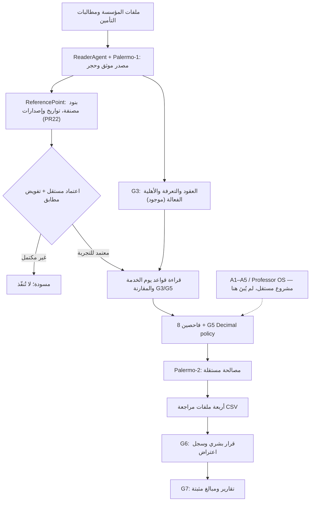

# MCIAS v2.0 — ابدأ من هنا: مرجع المطور والمعماري ومساعد البرمجة

**التاريخ:** 2026-10-17  
**حالة المستند:** مصدر شرح التعديلات الهندسية الواردة في PR #22، **وليس إعلانًا بأن النظام معتمد إنتاجيًا**.  
**المستودع:** https://github.com/overurdream-collab/test2  
**فرع العمل:** `feat/temporal-reference-inputs-and-four-outcomes`  
**المراجعة:** https://github.com/overurdream-collab/test2/pull/22 (Draft)  
**المخطط المعماري الأعلى (مسودة PR #19):** https://github.com/overurdream-collab/test2/pull/19  
**قواعد السلامة:** لا بيانات مرضى حقيقية، لا API خارجي دون تفويض، لا تصرف مالي أو طبي تلقائي، لا نشر على بيئة حقيقية قبل القبول المؤسسي.

## 1. ما الذي نبنيه؟ لماذا لا نبدأ من الصفر؟

MCIAS يدقق مطالبة تأمين صحي مقابل مصادر المؤسسة التي سبق أن وقعت عليها المؤسسة وشركة التأمين. قد يختلف سعر الخدمة نفسها باختلاف مقدم الخدمة وتاريخ الخدمة والعقد. الإدخالات ليست «أسماء خدمات» فقط: **كل بند تعاقدي مستقل**، مثل «مدة العقد سنة»، «عدد المستفيدين ألف»، أو «العلاج خارج الدولة غير مشمول»، وتُصنّف بحسب قسمها. قائمة الأقسام: العقود، مقدمو الخدمة، المستفيدون، نسب التحمل، الفئات، الاستثناءات، الموافقات، أسعار مقدم الخدمة.

**التصميم المتفق عليه:** عند دخول قسم مدخلات تظهر نقاط القسم مع تاريخ البداية، الانتهاء، الحالة، تاريخ الإصدارات، المصدر، وثلاثة أزرار **إضافة ملف** / **إضافة بند** / **تعديل بند**. تعديل المعتمد لا يحذفه أو يغيّر نصه؛ يضيف إصدارًا جديدًا وحدث إغلاق مستقلًا بتاريخ السريان الجديد، فيُستخدم القديم للمطالبات الأقدم.

الدور الحاسم للذكاء الاصطناعي مستقبلًا هو **استخراج مسودات البنود من مستند موثوق مع موضع النص** ثم المراجعة البشرية. ليس له سلطة اعتماد القواعد أو تغيير تعرفة مالية معتمدة.

## 2. خريطة النظام، مع الفصل بين المنفذ والمستهدف



**انتبه:** الرسم يحتوي أجزاء منفذة وأجزاء مستهدفة. الموجود حاليًا في PR #22 هو **سجل البنود، البحث الزمني، طبقة التوفيق القراءة فقط مع G3/G5، لوحة الواجهة، التصنيف الرباعي الأولي**. لا يوجد محرك معتمد لتفسير جميع البنود النصية أو AI مستخرج للعقود. أي بند معتمد غير قابل للتحقق آليًا يسبب `HUMAN_REVIEW`، وليس `PASS` متخيلاً. في الإنتاج الجديد يُحظر تفعيل تلك البنود حتى اعتماد توقيع مؤسسة مرتبط بالنسخة ذاتها.

## 3. خريطة الملفات (اقرأها بهذا الترتيب)

| الملف | الدور | الحالة |
|---|---|---|
| `mcias/models_reference.py` | G3: العقود الزمنية والتعرفة لكل عقد/مقدم خدمة والأهلية | موجود على main |
| `mcias/reference.py`, `reference_service.py` | السريان نصف المفتوح وأسبقية العقد واعتماد G3 | موجود |
| `mcias/models_reference_points.py` | بنود جديدة مع مصدر/نسخة/تاريخ وسجل إغلاق | PR22 |
| `alembic/versions/0019_reference_points.py` | ترحيل PostgreSQL وحواجز تاريخ البنود وعدم الحذف | PR22 |
| `mcias/reference_points.py` | إنشاء المسودة، تحقق النطاق والأرقام، الاعتماد، الاستبدال الزمني، عرض التاريخ | PR22 |
| `mcias/reference_points_api.py` | RBAC + عزل المؤسسة + واجهات البنود | PR22 |
| `mcias/reference_rule_bridge.py` | مقارنة بنود يوم الخدمة مع G3 وG5، وحجز التعارض أو غير المفسّر | PR22 |
| `mcias/audit_agents.py` | الفاحصون الثمانية وربط `reference_reconciliation` | موجود + توسعة PR22 |
| `mcias/audit_engine.py`, `audit_authorization.py` | Decimal، ترتيب الخصومات والتحقق المؤسسي الموقع | موجود؛ **لا يتغير منطق الحساب** |
| `mcias/audit_service.py` | تشغيل G5 وتجميد نتيجة وإصدار دليل البنود المستخدم | موجود + توسعة PR22 |
| `mcias/palermo2.py` | فحص مستقل للمدخلات العددية ونتيجة G5 | موجود؛ لا يقرّر رفضًا آليًا |
| `mcias/claim_outcomes.py` | تصنيف محافظ للنتائج الأربع وتصدير CSV آمن من الصيغ | PR22 |
| `mcias/claim_outcomes_api.py` | ملخص الدفعة وتحميل كل نتيجة مع صلاحيات القراءة والتصدير | PR22 |
| `mcias/web_workspace/reference_points_view.js` | شاشة أقسام المدخلات الثلاثية ونافذة البنود والتاريخ | PR22 |
| `mcias/web_workspace/audit_outcomes_view.js` | شاشة الملفات الأربع في صفحة الدفعات | PR22 |
| `mcias/web_workspace/views.js`, `workspace.css` | دمج العرض والاستجابة للجوال وRTL/LTR | موجود + توسعة |
| `tests/test_reference_rule_bridge.py` | تاريخ الخدمة، اختلاف مقدم الخدمة، العزل، المطابقة/الحجز | PR22 |
| `tests/test_reference_points_http_security.py` | اختبار API وصلاحية العرض/الكتابة وحدود المؤسسات | PR22 |
| `tests/test_temporal_point_persistence.py` | منع تعديل أو حذف النسخ، وإنشاء أحداث الإغلاق | PR22 |
| `tests/test_reference_points_and_outcomes.py` | العقد الرباعي، CSV والإدخالات غير الصحيحة | PR22 |

`docs/REFERENCE_POINTS_AND_OUTCOMES_HANDOFF_AR.md` هو ملخص تسليم سابق؛ هذا الدليل وما يليه يفصل طريقة العمل والقيود **ولا يمنح قبولًا مؤسسيًا**.

## 4. تمثيل البند وعلاقته بالأصل (مهم جدًا)

لكل `ReferencePoint`: 
- `organization_id` لعزل المؤسسة؛ `section` للقسم؛ `logical_key` هوية البند الثابتة؛ `version` رقم الإصدار.
- `title` و`clause_text` نص البند الفعلي كما وافقت المؤسسة على تفسيره، و`rule_type` نوع قيمة البند؛ لا تُعرَّف البنود بمثال واجهة.
- `provider_code` / `service_code` عند انطباقها، و`amount` Decimal / `currency` في بند سعر أو مبلغ.
- `effective_from` بداية سريان و`effective_until` حد نهاية **غير شامل**؛ `status` مسودة أو معتمد.
- `source_document_id` / `source_sha256` / `source_locator` للرجوع إلى المستند، و`supersedes_id` للنسخة القديمة، و`created_by` و`approved_by`.
- `ReferencePointClosure` سجل إغلاق مستقل غير قابل للتعديل فيه `point_id` و`replaced_by_id` و`effective_until` و`reason` و`approved_by` و`recorded_at`.
- **الانتهاء الفعلي** = انتهاء الأصل أو انتهاء الحدث المسجَّل إن وجد؛ لا تُحدّث قيمة النص الأصلي.

**مثال:** سعر CONSULT لمقدم H1: الإصدار الأول يبدأ 2026-01-01 بمبلغ 5000 YER. إصدار ثانٍ يبدأ 2026-07-01 بمبلغ 5500 YER؛ إغلاق القديم يصبح قبل 2026-07-01. مقدم H2 يمكن أن يظل 7000 YER في الفترة نفسها. **فاتورة يونيو تستخدم 5000، يوليو 5500، H2 سعره الخاص**. لا علاقة بتاريخ استيراد الفاتورة بتاريخ اختيار السعر.

## 5. قاعدة مصدر السلطة: ترتيب الأولوية

1. **G3 ContractVersion/ProviderTariff**: المصدر المالي الأصلي ذو عقد وتاريخ ومقدم ورمز خدمة، بتفويضه وفحوصه السابقة.
2. **G5 AuditPolicy**: سياسة مالية موقعة لها `policy_fingerprint` ومنح مؤسسي صالح؛ يجب أن يتطابق `policy.tariff` مع G3. لا يُخلق تعديل مالي من استخراج AI.
3. **ReferencePoint (المضاف)**: سجل البنود المعتمدة بالإصدار والتاريخ؛ دوره الحالي **التوفيق والتحقق من التعارض** لا استبدال G3/G5.
4. إذا تعارض بند سعر مرجعي مع G3 أو G5: `HOLD`/مراجعة، **لا نأخذ الجديد أو الأرخص عشوائيًا**.
5. لا يوجد بند جديد فعّال أو بند عند تاريخ الخدمة: يُستخدم مسار G3/G5 السابق إن كان مكتملًا؛ لا تُخلق قاعدة غير موجودة. تظل فجوة «هل اكتملت جميع شروط العقد؟» مطلب قبول مؤسسي منفصل.
6. البنود غير المعروفة من قسم العقد أو الموافقات أو المزايا لا تُفسّر لغويًا إلى أمر خصم؛ تسجّل `uncompiled_<section>_point` وتصبح مراجعة بشرية. 
7. تقاطع مفاهيم متعددة أو مراجع تعاقدية متعارضة يُوقف الفحص؛ لا يوجد ترتيب أولويات مستنبط آليًا.

## 6. خطوات الاستخدام عبر الواجهة / API

**استيراد ملف:** `POST /api/v1/ingestion/uploads?filename=<safe-name>` لرفع المصدر عبر مسار المصدر الحالي؛ تُعاد بيانات المصدر. **ليس استخراجًا تلقائيًا لكل بنود العقد حتى الآن.** يستعرض المختص الوثيقة ثم يُدخل البنود الموثقة كمسودات.  
**قائمة البنود:** `GET /api/v1/reference-points?section=contracts&limit=100&offset=0`؛ للمطالبات القديمة يُضاف `at=YYYY-MM-DD`؛ التصفية قبل الترحيل بين الصفحات.  
**مسودة:** `POST /api/v1/reference-points` بـ`reference.write` و`workspace.super_admin`. لا يصح `status=approved` في الطلب.  
**تعديل:** إرسال مسودة جديدة بنفس `logical_key`، مع `supersedes_id` وقيمة `effective_from` الجديدة. لا حقل API يسمح بحذف أو تعديل نص المعتمد. تعديل رجعي غير متاح دون workflow رسمي.  
**اعتماد:** `POST /api/v1/reference-points/{id}/approve` بـ`reference.approve` ومراجع مستقل وتفويض مصدر كتابي؛ **محظور في production** حتى تحقق توقيع مؤسسي مرتبط بالمحتوى، وليس بتفويض عام.  
**تفاصيل:** `GET /api/v1/reference-points/{id}`.  
**ملفات المطالبات:** `GET /api/v1/audit-outcomes/batches/{batch_id}/summary` أو `GET /api/v1/audit-outcomes/batches/{batch_id}/export/{REJECTED_RULE_CERTAIN|ACCEPTED_RULES|MISSING_ATTACHMENTS|HUMAN_REVIEW}`. تتطلب `claims.read` مع `reports.read` أو `reports.export`.  
**واجهات المستخدم:** `/admin/reference-data` سجل الأقسام والبنود؛ صفحة دفعات المطالبات تحتوي بطاقة اختيار الدفعة وتنزيل أربع ملفات CSV. `/institution/providers` يعرض سجلاً قراءةً حسب الصلاحيات.

## 7. المسار المالي التفصيلي

```
ClaimEntry (tenant, provider, service, service_date, amount, currency)
  -> inspect_claim(): BeneficiaryEnrollment + active_contract() + ProviderTariff
  -> reference_rule_bridge.reconcile(): only approved points on service_date, scoped by tenant/provider/service
     - tariff: exact amount and currency must match BOTH G3 AND signed G5 policy
     - cost-sharing: only explicitly supported copay_percent / scoped key verified against signed policy
     - exclusions: only explicitly supported exclusion_amount / scoped key verified against signed policy
     - other clauses: hold as uncompiled, never silently PASS
  -> 8 deterministic finding statuses (PASS / HOLD / REVIEW; original order unchanged)
  -> run_audit(): reference_reconciliation.status != pass => calculation held, no deductions
  -> otherwise approved G3 tariff == G5 AuditPolicy.tariff and Decimal evaluate()
  -> Palermo-2.verify() independently checks arithmetic/fingerprint/agent status
  -> immutable AuditSnapshot stores original findings + reference_reconciliation (IDs, versions, hashes, dates)
  -> claim_outcomes.classify(): one provisional review category per claim
  -> G6 independent human disposition; G7 published report only after established gates
```

**قاعدة مهمة:** إذا لم يعمل الوكيل A1 أو لم يوجد مستند، لا يجوز نسب استنتاجات AI إلى الفاحصين الثمانية. التصنيف ليس مدخل G5، بل قراءة محافظـة من لقطته.

## 8. حالات الإخراج الأربع

| المجلد/رمز الحالة | تعريفها البرمجي الحالي | ما لا تعنيه |
|---|---|---|
| `REJECTED_RULE_CERTAIN` | فشل حتمي `fail_confirmed` مع دليل مرجعي وتحقق Palermo `verified` | ليس رفضًا قانونيًا أو ماليًا نهائيًا |
| `ACCEPTED_RULES` | اجتازت الفحوص الثمانية وPalermo الحساب، بلا تعليق لقواعد زمنية | ليس أمر دفع |
| `MISSING_ATTACHMENTS` | `evidence` في حالة `hold` وبدون رفض مثبت | ليس اتهامًا أو رفضًا |
| `HUMAN_REVIEW` | مراجع ناقصة أو متعارضة، أو نص غير قابل للترجمة الآمنة أو لقطة غير متوفرة | ليس فشلًا قطعيًا |

**تفصيل مهم:** فاحص الأهلية الحالي إذا غاب المستفيد يرجع `hold`، وليس «غير مستفيد» مثبتًا؛ لم يُنفّذ توثيق اكتمال القائمة رسميًا. وفاحص Palermo الحالي يحجز أي فشل في محركات القواعد؛ لذا **قد يبقى ملف الرفض القطعي فارغًا** حتى يُبنى مسار تحقق مستقل لرفض قاعدي صريح. لا تُعرض أرقام رفض مختلقة.

كل مطالبة في ملف واحد لكل دفعة / نسخة تقرير؛ ممكن أن تحتوي على أسباب فرعية أكثر من سبب. CSV يحمل `claim_id`, `claim_reference`, `provider_code`, `service_date`, `claimed_amount`, `currency`, `outcome`, `reason`, `audit_snapshot_id`, `policy_fingerprint`, `reference_versions`, `review_state`. لا تجمع العملات. لا تعتبر أي مبلغ ملف «الوفورات المحققة» دون مسار مصالحة مستقل.

## 9. التشغيل المحلي الآمن والاختبار

```bash
python -m pip install -e '.[test]'
# قاعدة PostgreSQL اختبارية معزولة فقط؛ لا تستخدم قاعدة الجهة
export MCIAS_TEST_DATABASE_URL='postgresql+psycopg://<TEST_USER>:<TEST_PASSWORD>@127.0.0.1:5432/<TEST_DB>'
alembic upgrade head
python -m pytest -q tests/test_reference_points_and_outcomes.py \
  tests/test_temporal_point_persistence.py \
  tests/test_reference_rule_bridge.py \
  tests/test_reference_points_http_security.py
# اختبارات الانحدار الرئيسية، وكذلك مهام GitHub Actions
python -m pytest -q tests/test_g5_agent_order.py tests/test_g5_engine.py
```

يجب تحديد إعدادات التطبيق المحلية وأسرارها من ملفات محمية خارج Git قبل تشغيل واجهة تسجيل الدخول على localhost. **لا توضع كلمات المرور أو رموز الجلسات أو البيانات الطبية في Git.**

راجع اختبارات GitHub Actions على SHA المحدد في سجل التنفيذ `docs/MCIAS_V2_EXECUTION_JOURNAL_AR.md`. الاختبارات الناجحة لا تعني اعتماد المستشفى/شركة التأمين.

## 10. كيف يتصرف Codex أو المطور عند استكمال المشروع؟

- اقرأ هذا الملف ثم `docs/MCIAS_V2_EXECUTION_JOURNAL_AR.md` ثم `docs/MCIAS_V2_ACCEPTANCE_MATRIX_AR.md` ثم المخطط PR #19 ووثائق G3/G5/G6/G7. لا تغيّر قواعد الأعوام أو أسعار المستشفى وفق تخمين.
- لكل تعديل: نطاق واضح + تحديث هذا الدليل عند تغير السلوك + اختبارات موجبة/سالبة/تزامن/عزل + CI + مراجعة مستقلة، ثم Draft PR. لا تدمج تلقائيًا.
- لا تعلن «مكتمل» إن كان AI لم يعمل، أو لم يرتبط البند بتوقيع معتمد، أو لم تثبت دقة التصنيف والإنذارات الخاطئة.
- أي قرار قانوني/طبي/مالي غير محسوم يأخذ `HOLD` أو `HUMAN_REVIEW`. كل مطالبة قديمة تُراجع بقواعد **تاريخ الخدمة** وتحفظ بصمة النسخة في تقرير التدقيق.
- لا تغيّر G3 وG5 ليقبلا مصادر جديدة بسهولة على حساب `policy_fingerprint` والتفويض، ولا تعِد كتابة اللقطات القديمة.
- قوائم TODO الحقيقية موثقة في سجل التنفيذ؛ وجود الشاشة لا يعني اكتمال خدمة استخراج العقود أو الاعتماد الإنتاجي أو وكلاء A1–A5.


## Contract Intelligence: new evidence gate on child PR #23
- mcias/contract_intelligence.py: make_source_blocks() reads existing G2 ExtractedSourceRecord shapes; validate_candidates() rejects unsupported locator/quote/numeric/date/tenant-independent identity at pure layer and returns **DRAFT_ONLY** records; infer_local() opens explicit localhost-only OpenAI-compatible POST, no external proxy or cloud fallback, requires model id+revision.
- There is **no live API or UI integration yet** and **no real model inference**. API must enforce organization scope plus RBAC/field-level access prior to using G2 records; never hand public model data.
- tests/test_contract_intelligence.py: positive/negative synthetic anchors, wrong provider, OCR price mismatch, prompt injection as untrusted content, SSRF and unavailable inference. Read exact CI status before claiming any pass.
