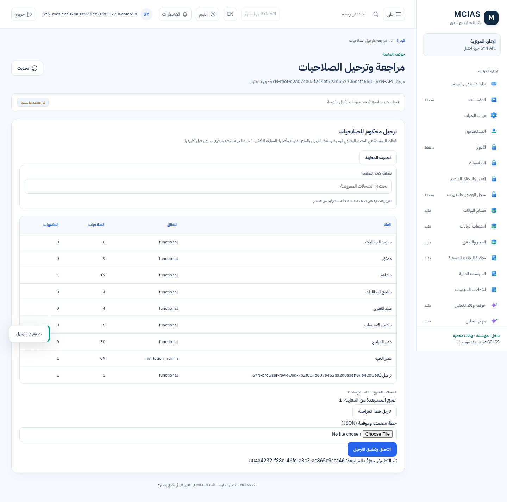
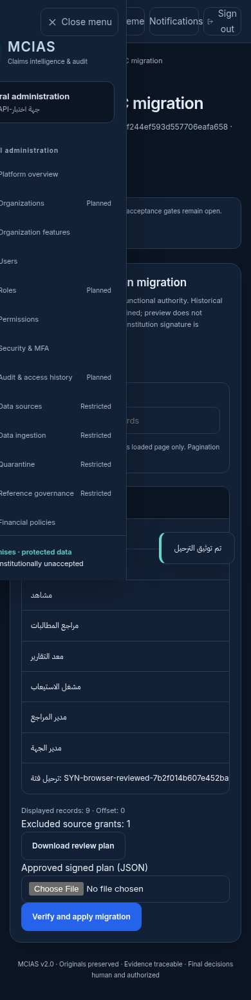

# تقرير توحيد RBAC — تحقق هندسي على بيئة معزولة

الفرع: `feat/windows-laptop-testing`.

مرجع البداية: `223c693a50c72c91450c0f495613e8c99dd9389a`. النتائج أدناه تخص كود التغيير في هذه الحزمة قبل نشر Commit، وليس نسخة main أو بيانات جهة حقيقية. جرى الاختبار في 12–13 أكتوبر 2026 على PostgreSQL 16 وPython 3.12 وChromium، وعلى صورة Docker مبنية من كود التغيير.

## التنفيذ

- مصدر وظيفي واحد: الفئات المراجعة، دون اتحاد مع UserRole/RolePermission أو UserPermission.
- الحساب التقني مع MFA يدير الإعداد، ولا يعتمد ماليًا. يحمي المنع API وخدمات اعتماد العقود/القواعد وسجل السياسة المالية، ويشمل هوية المعتمد التقني في التفويض المالي.
- مدير الجهة يدير الموظفين والفئات المعتمدة المرتبطة بهم، دون تغيير صلاحيات الفئة أو إسناد نفسه.
- ترحيل معتمد بخطة دقيقة وتوقيع جهة مستقل، وحفظ سجلات المنح الأصلية وروابطها دون حذف.
- تعيين مدير الجهة الأول عبر عضوية صريحة في خطة إعداد موقّعة، دون منح ذاتي أو تجاوز تقني.
- التاريخ الجديد append-only، وهوية المنح ثابتة، وروابط أصل المنح مقيدة بالجهة.
- سحب المنح والعضويات يعطل الوصول دون رجوع إلى المنح القديمة.
- أقفال G6/G8 تحافظ على تسلسل العمليات دون توسيع UPDATE للسجلات التاريخية.

## نتائج التشغيل المحلي

| الفحص | النتيجة | نطاق الدليل |
|---|---|---|
| pytest كاملاً مع قواعد PostgreSQL منفصلة | **543 ناجح / 0 فاشل / 0 متجاوز** | تشمل اختبارات API، الهيكل، G1–G9، الترحيل، الأمان والعزل وحفظ تاريخ المنح عند إعادة المعاينة في يوم آخر |
| JavaScript | **17 ناجح / 0 فاشل** | اختبارات frontend القائمة |
| فحص صياغة JavaScript | ناجح | npm run check + node --check للملف الجديد |
| 0022 على قاعدة فارغة | upgrade → downgrade 0021 → upgrade ناجح | اختبار PostgreSQL مستقل |
| 0022 على قاعدة بها بيانات ومنح وتاريخ | المسار نفسه ناجح، والسجلات الأصلية مطابقة | مقارنة JSON لجداول المستخدمين والمنح والسجل قبل وبعد |
| حساب تشغيل PostgreSQL محدود | ناجح | إنشاء موظف، عضوية، نقل ذري، إغلاق، منع UPDATE شامل والحذف |
| حماية قاعدة البيانات | ناجح | رفض تغيير هوية المنح، والربط بين جهتين، وتعديل/حذف تاريخ RBAC |
| تجربة الواجهة العامة | 95 مسارًا؛ دون أخطاء JavaScript أو مخالفات WCAG | Chromium، العربية/الإنجليزية والاستجابة |
| الدورة التشغيلية الكاملة | ناجحة | رفع واستخراج واستيراد وأدلة ومراجعة مستقلة وتقرير واعتراض وإعادة تدقيق |
| شاشة ترحيل الصلاحيات | ناجحة | MFA، تنزيل معاينة، رفع خطة موقعة، تطبيق، إعادة دون تكرار، سحب وصول |
| ميزات الجهة والمدخلات | ناجحة | المنح/السحب والتنقل و16 مسار مدخلات والإغلاق ونسخ السجلات والاستيراد |
| Docker | البناء والتشغيل ناجحان | المستخدم غير الجذر؛ حساب قاعدة تشغيل غير مالك |
| دورة اللابتوب داخل Docker | نجاح الدخول وMFA والمدخلات، وإعادة setup، واستمرار البيانات | فحوص حقيقية على profile معزول؛ لم يُجرَ هذا الاختبار على جهاز Windows للمستخدم |

ظهرت 32 رسالة تحذير غير فاشلة في pytest عن deprecations موجودة في FastAPI/TestClient وAlembic. لا تمثل أخطاء اختبارات. لم تُضف تبعيات جديدة.

فشل الفحص الأول لبعض التوقعات القديمة لأنها كانت تمنح صلاحيات فردية أو تسمح لمدير الجهة بتغيير الفئات. عُدلت تلك التوقعات بما يثبت المنع الجديد؛ لم تُحذف الاختبارات. كشف التشغيل بالحساب المحدود نقص صلاحية القفل في G6؛ عولج بتسلسل داخل المعاملة دون منح UPDATE للقرارات. أعيدت دورة المتصفح بنجاح بعد الإصلاح.

## دليل المتصفح

شاشة الترحيل تعرض بيانات SYN اصطناعية. لا تحتوي اللقطات على كلمات مرور أو مفاتيح توقيع.

## إعادة الاختبار

شغّل `pytest tests/ -q` مع قواعد معزولة عبر `MCIAS_TEST_DATABASE_URL` و`MCIAS_RBAC_API_DATABASE_URL` و`MCIAS_SEED_TEST_DATABASE_URL`. اختبار Seed يتطلب development وقاعدة باسم ينتهي بـ `_e2e`، وسجل مفاتيح اختبار خاصًا عبر `MCIAS_RBAC_TRUST_REGISTRY`.

شغّل `npm test` و`npm run check`. اختبارات المتصفح القابلة للإعادة تشمل `scripts/check_rbac_migration_browser.py` إضافة إلى أدوات workspace/workflow/features الموجودة. تحتاج Chromium وPlaywright وقاعدة اختبار ومفاتيح تشفير اصطناعية مستقلة، وتُحفظ نتائجها في `.e2e-output` خارج Git. يتضمن CI هذه التجربة ويرفع النتائج والصور كـ artifacts.

## حدود النتيجة

هذه نتائج هندسية اصطناعية فعلية، وليست توقيع قبول مؤسسي أو نتيجة UAT أو PenTest. لم يُفعّل أي منح على قاعدة عميل، ولم تُدخل بيانات طبية حقيقية. يتطلب التفعيل المؤسسي توقيع الجهة على خطة المنح وسجل مفاتيحها العام المحمي. تظل قرارات السياسة المالية والتفويض والاحتفاظ والاعتماد المؤسسي مستقلة عن اعتماد RBAC.

راجع [خطة التشغيل والترحيل](RBAC_UNIFICATION.md). تُقرأ نتائج CI المنشورة عند Commit المحدد في GitHub؛ لا تُنسب نتائج محلية أو تاريخية إلى تشغيل CI لم يكتمل.
